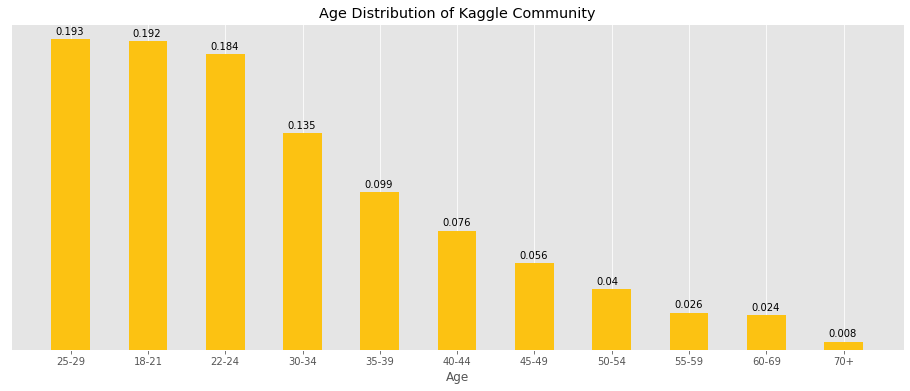
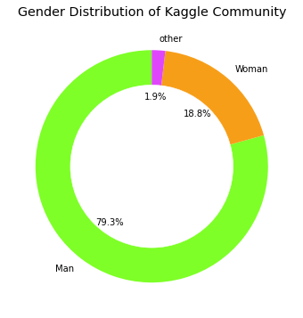
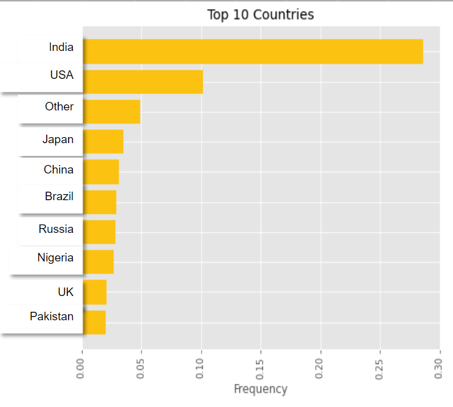
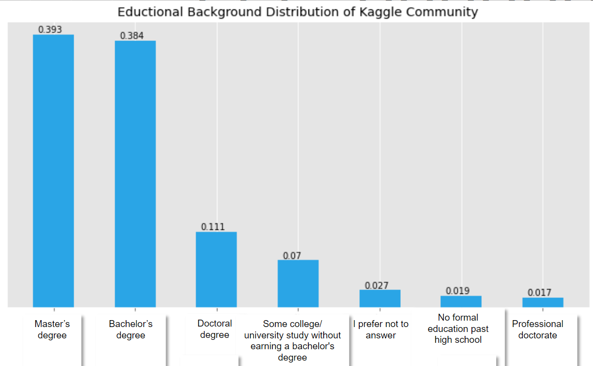
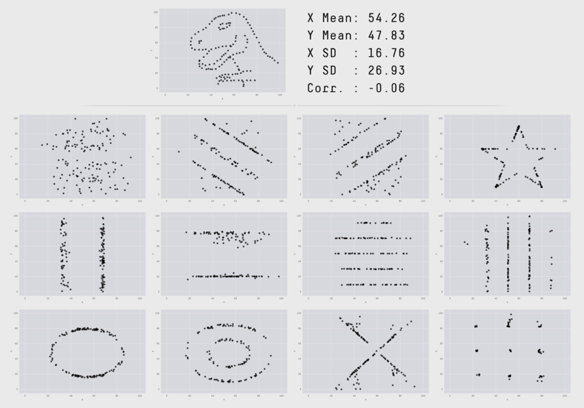
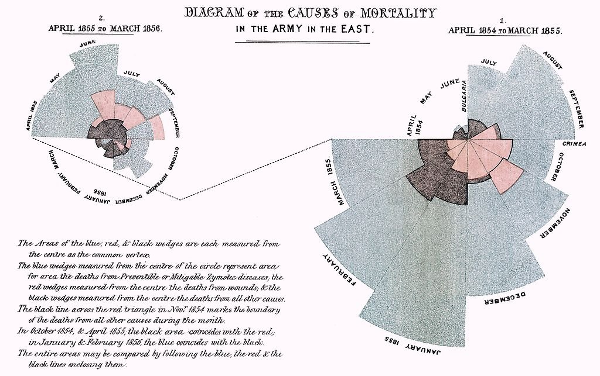
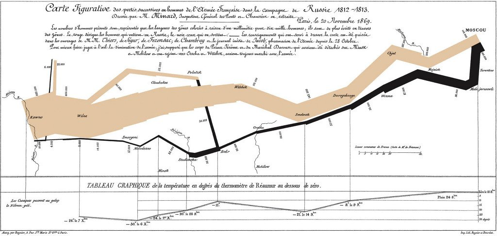
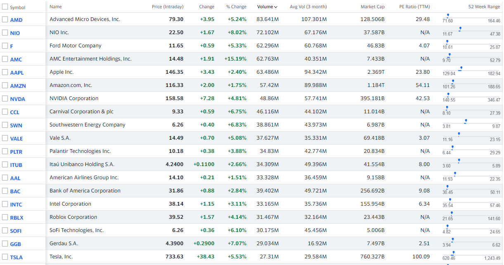
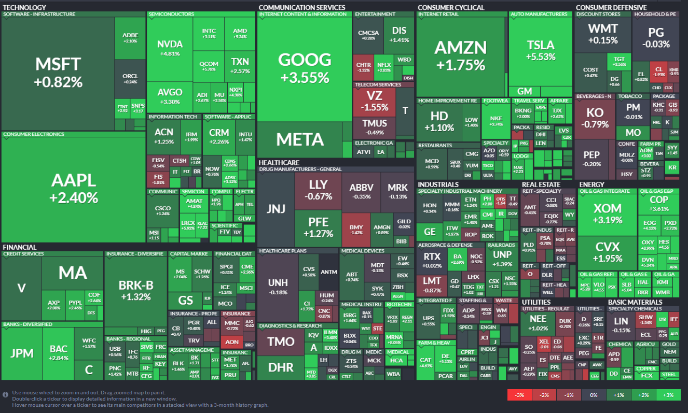

## 학습 목표
- 데이터 시각화가 왜 필요한지 사례로 설명할 수 있음
- 데이터 시각화의 정의, 효과, 목적(탐색/설명)을 설명할 수 있음

## 1. 데이터 시각화의 필요성
### 표만으로는 답하기 어렵다 — Kaggle 사용자 설문
- [Kaggle Survey 2020](https://www.kaggle.com/c/kaggle-survey-2020/data): 응답자 2만여 명, 질문 39개 (Q1 나이, Q2 성별, Q3 국가, Q4 학위 …)
- 표를 보고 다음 질문에 답해 볼 것
  - 어떤 **연령대**가 데이터 분석을 많이 할까?
  - **성별**은? **국가**는? **학위**는?
- 수만 행의 표로는 바로 답할 수 없음. 막대그래프 하나로 그리면 바로 보임

*Kaggle 사용자의 연령·성별·국가·학위 분포*

### 같은 통계, 다른 데이터 — Datasaurus Dozen
- 평균, 표준편차, 상관계수가 **거의 같은** 데이터셋 13개(공룡 모양 1개 + 12개)임
- 요약 통계만 보면 같은 데이터처럼 보이지만, 그려 보면 공룡, 별, 원, 줄무늬처럼 전혀 다름
- 교훈: **요약 통계만 믿지 말고 반드시 그려 봐야 함.** 같은 원리를 보여 주는 앤스컴 콰르텟은 [07 문서](/lectures/data-visualization/07_scatter-plot/)에서 직접 그려 봄

*Datasaurus Dozen*

## 2. 데이터 시각화 사례
### 나이팅게일의 '사망 원인 도표' (1858)
- 원래 이름: *Diagram of the Causes of Mortality in the Army in the East*
- 크림전쟁에서 **전투보다 전염병으로 죽는 병사가 훨씬 많음**는 사실을 보여 줘 정부를 설득했음. 그 결과 병원 위생 개혁으로 이어졌음
- 차트 형태: 나이팅게일 차트(로즈 다이어그램) → [06 문서](/lectures/data-visualization/06_comparison-chart/)

*나이팅게일의 사망 원인 도표*

### 미나르의 '나폴레옹 모스크바 침공 다이어그램' (1869)
프랑스 공학자 샤를 미나르가 1812년 러시아 원정의 진격과 퇴각을 한 장에 담았음

| 시각 요소 | 표현한 데이터 |
|---|---|
| 선의 두께 | 병사 수 |
| 선의 색 | 진격(밝은색) / 퇴각(검은색) |
| 선의 위치 | 이동 경로 |
| 아래쪽 차트 | 퇴각 중 기온 |
| 텍스트 | 지명, 날짜 |

> 하나의 그림에 **6개 변수**(병사 수, 위도, 경도, 방향, 기온, 날짜)를 담은 대표 사례임

*미나르의 나폴레옹 러시아 원정 다이어그램*

### 표 vs 그래프
- 같은 주가 데이터도 숫자 표(야후 파이낸스)로 보면 흐름이 안 보임. 차트나 히트맵(핀비즈)으로 보면 바로 이해됨

*표(야후 파이낸스) vs 그래프(핀비즈)*

## 3. 데이터 시각화란
> 방대한 양의 정보를 한눈에 이해할 수 있도록 **데이터의 관계와 분포**를 차트, 그래프, 지도 형태로 전달하는 것

> "시각화란 숫자를 공간에 배치해 보여 줌으로써 그 패턴을 인지하게 만드는 것임. 인간에게는 탁월한 패턴 인식 능력이 있음. 데이터 시각화는 통계 분석 기법으로는 도저히 알 수 없는 데이터의 이야기를 끌어낼 것임." — 《비주얼라이즈 디스》(네이선 야우)

참고 영상: [Giorgia Lupi — How we can find ourselves in data (TED)](https://www.ted.com/talks/giorgia_lupi_how_we_can_find_ourselves_in_data)

## 4. 데이터 시각화의 효과
- 정보를 얻는 시간이 줄고, 상황을 즉시 판단할 수 있음
- 데이터에서 통찰을 얻을 수 있음
- 이해관계자에게 데이터를 편견 없이 보여 줄 수 있음
- 내용을 기억하기 쉽음
- 흥미를 끌어 정보가 빠르게 퍼짐
- **추세와 이상치**를 판단하기 좋음

## 5. 데이터 시각화의 목적

| 목적 | 설명 | 예 |
|---|---|---|
| **탐색** (Exploratory) | 데이터에서 정보를 찾아내기 위해 | 분석가가 EDA 단계에서 그리는 그래프 → [12 문서](/lectures/data-visualization/12_eda/) |
| **설명** (Explanatory) | 아이디어를 전달하고 설명하기 위해 | 보고서, 발표, 인포그래픽 |

## 정리
- 요약 통계만으로는 데이터를 오해할 수 있음 (Datasaurus)
- 좋은 시각화는 의사결정을 바꿈 (나이팅게일)
- 시각화의 목적은 **탐색**과 **설명** 두 가지임
