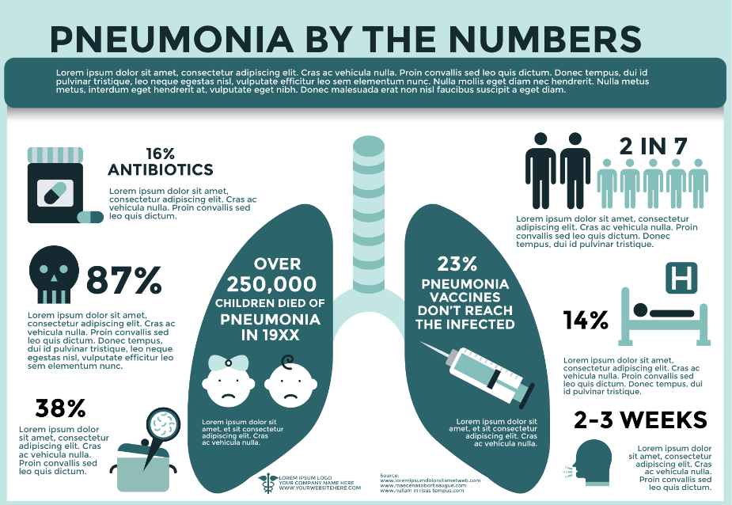
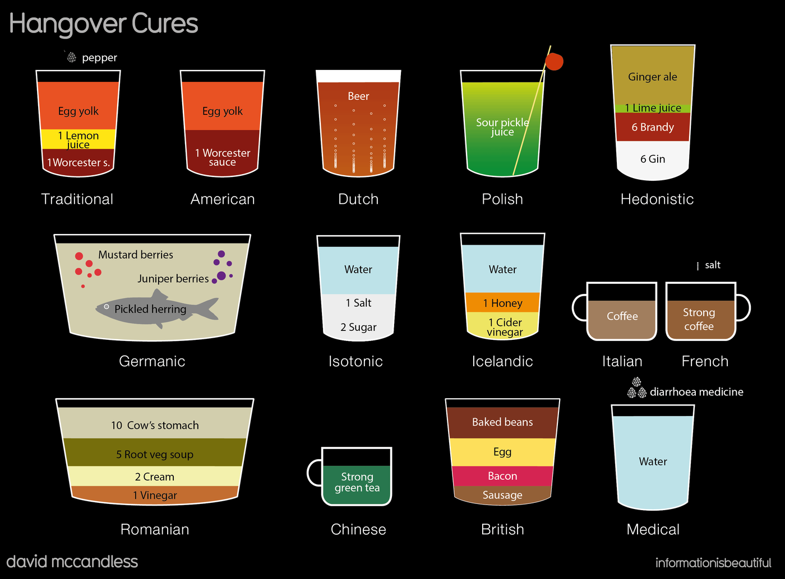
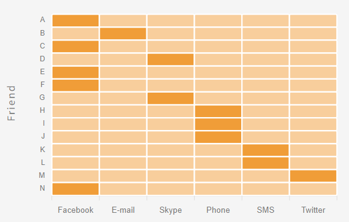
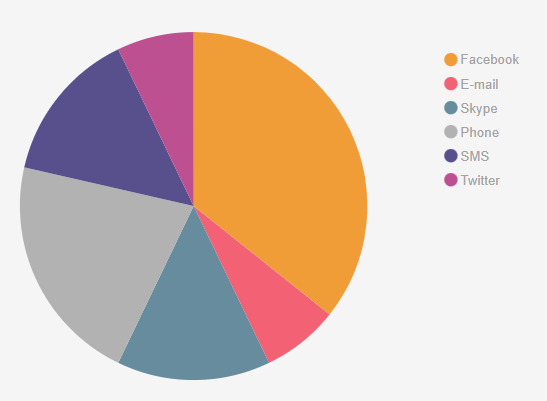
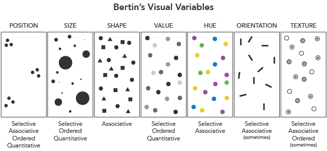
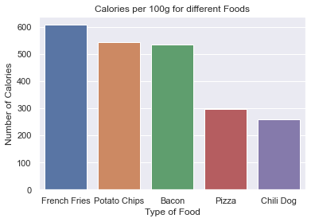
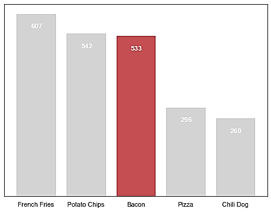

## 학습 목표
- 데이터 시각화 프로세스와 DIKW 위계를 설명할 수 있음
- 정보 디자인 3단계(구조화 → 그래프 가공 → 시각적 표현)를 설명할 수 있음
- ACCENT 원칙으로 시각화를 평가할 수 있음

## 1. 데이터 시각화 프로세스

```
데이터 ──①Visual Encoding──▶ 시각화 ──②Perception──▶ 사람
   ▲                                                    │
   └──────────────③Interaction──────────────────────────┘
```

1. **시각적 부호화(Visual Encoding)**: 수집한 데이터를 플롯이나 그래프로 바꿈
2. **인지(Perception)**: 사람이 시각화 결과를 보고 정보를 알아챔
3. **상호작용(Interaction)**: 알아챈 정보를 바탕으로 데이터와 시각 자료를 다시 탐색함

## 2. 인포그래픽
- 정보(Information)와 그래픽(Graphic)을 합친 말임
- 신문, 잡지, 정부 홍보물, 기업 제품 홍보 등에 쓰임
- 참고: [easel.ly](https://www.easel.ly/), [Information is Beautiful](https://informationisbeautiful.net/)





*인포그래픽 사례*

## 3. 시각적 이해의 위계 (DIKW)

| 단계 | 상태 | 설명 | 전환 방법 |
|---|---|---|---|
| 데이터 (Data) | 분리된 요소 | 가공되지 않아 의미가 없는 개체 | |
| 정보 (Information) | 연관된 요소 | 데이터 간의 관계와 패턴을 보이게 한 것 | 맵핑 |
| 지식 (Knowledge) | 조직화된 정보 | 여러 영역의 정보를 스스로 조직해 얻은 것 | 디자인 |
| 지혜 (Wisdom) | 적용된 지식 | 지식을 내면화해 개인의 맥락에 담은 것 | 시각화 |

### 정보 인터랙션 디자인
- 정보(Global) → 지식(Local) → 지혜(Personal)
- 단계마다 시각화 방법이 다름. 지식으로 갈수록 **경험에 기반한 스토리텔링**이 중요해짐

## 4. 정보 디자인 프로세스
> 정보 시각화는 데이터 수집과 마이닝보다 **그래프 가공과 시각적 표현**에 집중함

### ① 정보의 구조화 — 데이터 수집·정제·데이터셋 만들기

| 단계 | 설명 |
|---|---|
| 데이터 수집 및 탐색 | 의미 있는 데이터를 고르고 의미 없는 데이터를 걸러냄 |
| 데이터 분류 | 카테고리나 태그로 분류 (csv, json, xml) |
| 데이터 배열 | **LATCH** 기준으로 배열 |
| 데이터 재배열 | 보는 사람이 알아보기 쉽게 패턴을 만듦 |


*정보 디자인 프로세스*

**LATCH**: 정보를 정리하는 5가지 기준

| 기준 | 예 |
|---|---|
| **L**ocation (위치) | 지도, 지역별 |
| **A**lphabet (알파벳·가남) | 사전, 전화번호부 |
| **T**ime (시간) | 연표, 시계열 |
| **C**ategory (카테고리) | 상품 분류 |
| **H**ierarchy (계층·크기) | 순위, 크기순 |

> 재배열은 패턴을 드러내지만, 잘못하면 **틀린 정보를 전달**할 수 있으니 주의해야 함

### ② 그래프 가공 — 도구로 표현하기
- 도구가 주는 그래프를 **왜, 어떤 이유로, 어떻게** 쓰는지가 중요함
- 시각화 유형: **시간, 분포, 관계, 비교, 공간** 시각화 → [11 차트 선택 가이드](/lectures/data-visualization/11_chart-selection/)
- 같은 목적도 방법은 여러 가지임. 예를 들어 친구에게 생일 축하를 받는 방법이 문자, 전화, 카드로 다르듯, 전달할 내용에 맞는 형태를 고름





*같은 데이터(생일 축하 메시지 수단)를 다르게 표현한 예*

### ③ 시각적 표현 — 그래프 다듬기
- 시각적으로 마무리하는 단계임. 의도를 정확히 전달하도록 그래픽 요소를 더하고, 표현을 다듬으며 실험함
- **인터랙션 디자인**: 사용자가 정보에 마음대로 접근하고 골라서 탐색할 수 있게 함 → [14 Plotly](/lectures/data-visualization/14_plotly-overview/)

**그래픽 7요소 (시각 변수)**

| 요소 | 의미 |
|---|---|
| Position | 위치 |
| Size | 크기 |
| Shape | 모양 |
| Value | 명도 |
| Color (Hue) | 색상 |
| Orientation | 방향 |
| Texture | 질감 |

출처: [Axis Maps — Visual Variables](https://www.axismaps.com/guide/general/visual-variables/)



*베르탱의 시각 변수 (Bertin's Visual Variables)*

**다듬기 예**: 배경과 범례를 없애고 수치를 그래프 안에 직접 쓰면 표현력이 높아짐

```python
ax = sns.barplot(x=['A', 'B', 'C'], y=[30, 45, 25], color='steelblue')
ax.bar_label(ax.containers[0])          # 막대 위에 값 표시
sns.despine(left=True)                  # 테두리 제거
ax.set(yticks=[])                       # y축 눈금 제거
plt.show()
```





*다듬기 전과 후*

## 5. 좋은 데이터 시각화란
- **인사이트를 쉽게 얻을 수 있어야** 함
- 화려한 그래프보다 분석 내용을 **효율적으로 전달**하는 그래프를 고름

### ACCENT 원칙 (D. A. Burn) — 시각화의 효율성을 정하는 6가지

| 항목 | 질문 |
|---|---|
| **A**pprehension | 변수 간의 관계를 알아보기 쉬운가? |
| **C**larity | 모든 요소를 쉽게 구별할 수 있는가? |
| **C**onsistency | 다른 그래프와 비슷한 방식으로 해석할 수 있는가? |
| **E**fficiency | 해석하기 쉬운가? (복잡하지 않은가) |
| **N**ecessity | 그래프가 꼭 필요한가? |
| **T**ruthfulness | 척도가 실제 값을 믿을 수 있게 보여 주는가? |

## 6. 시각화할 때 유의사항
- 빅데이터 시각화는 **도구가 결과를 좌우**하는 경향이 강함
- 도구가 주는 그래프에만 의존하면 분석적 사고보다 **멋져 보이는 그래프**를 고르기 쉽음
- 차트의 쓰임새를 익히고, 분석 내용을 효율적으로 전달하는 수단으로 써야 함

## 정리
- 프로세스: Visual Encoding → Perception → Interaction
- 정보 디자인: **구조화(LATCH) → 그래프 가공 → 시각적 표현(7요소)**
- 평가 기준: **ACCENT**
