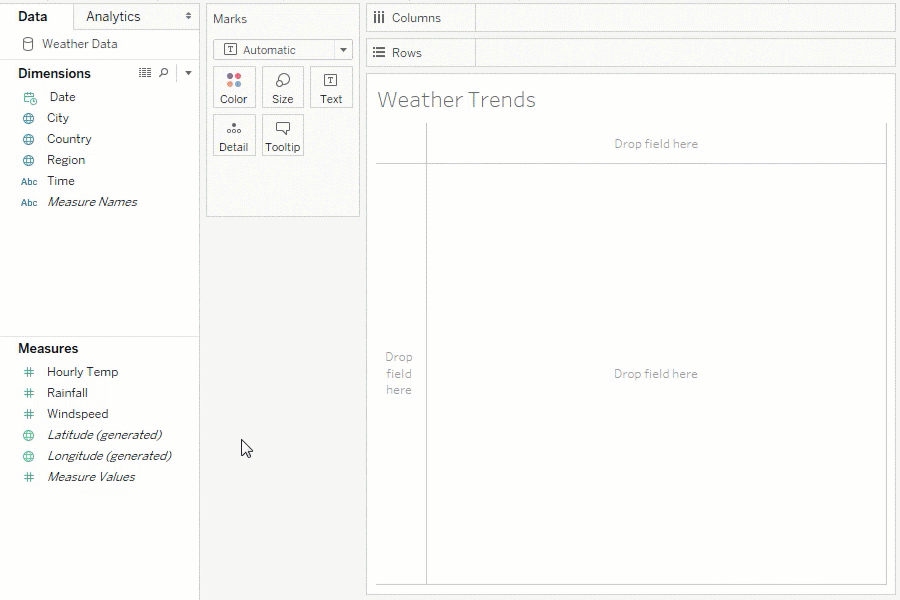
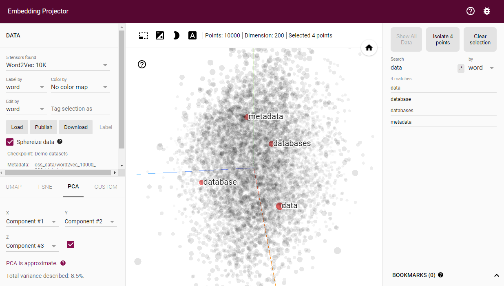
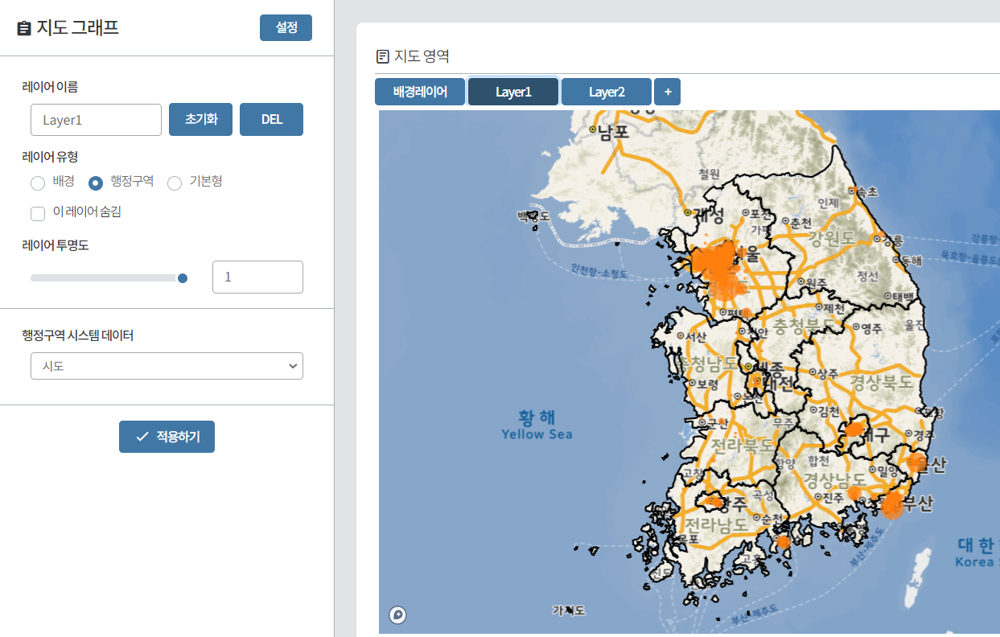
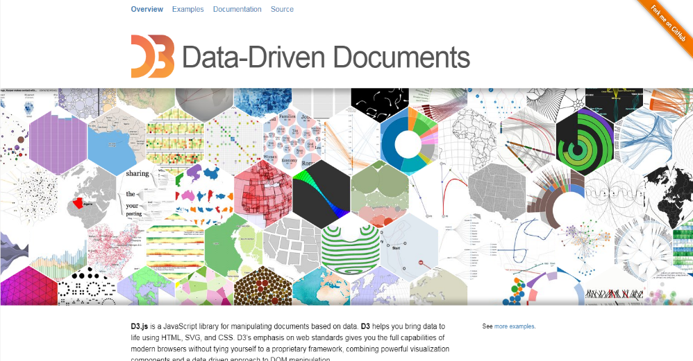
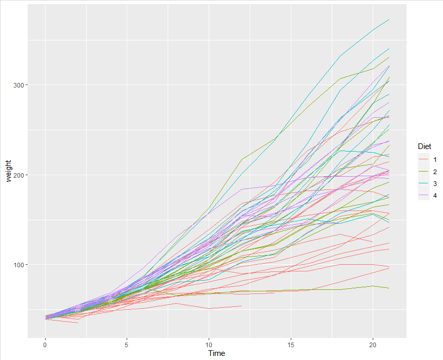
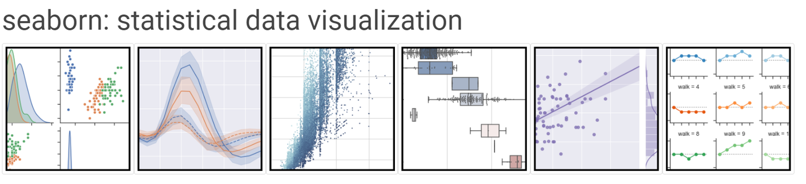
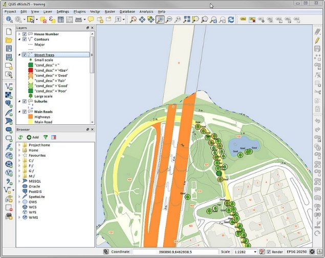
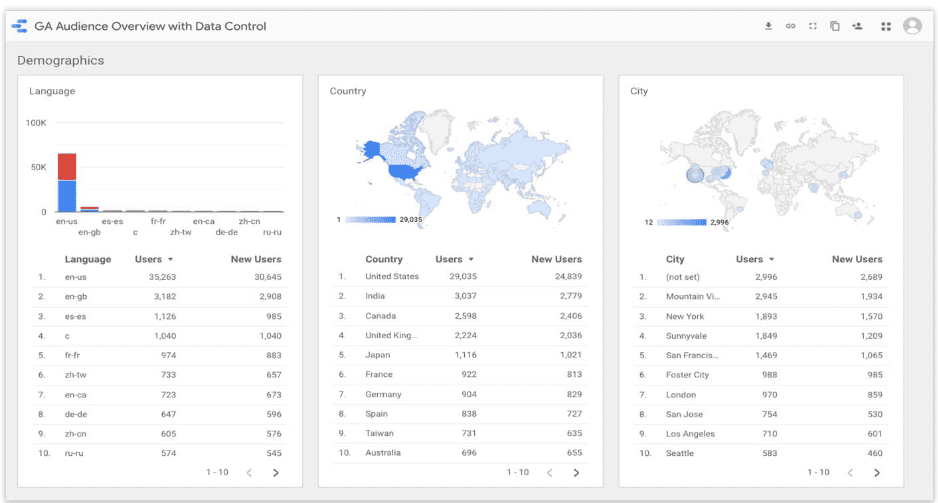
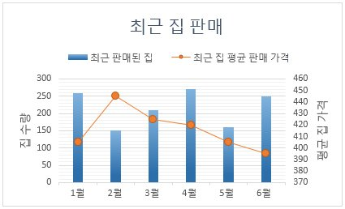
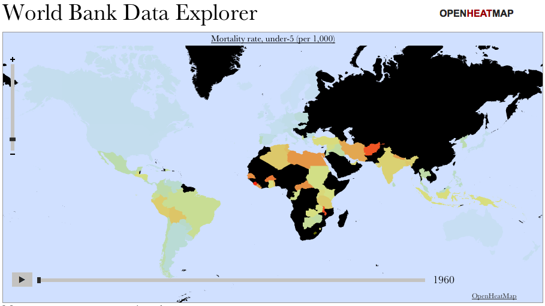

## 학습 목표
- 시각화 도구를 UI 기반, 프로그래밍 기반, 기타로 나눠 특징을 설명할 수 있음
- 목적에 맞는 도구를 고를 수 있음

## 1. UI 기반 시각화 도구
코드를 쓰지 않고 마우스 조작으로 시각화함

| 도구 | 특징 | 링크 |
|---|---|---|
| **Tableau** | 엑셀과 비슷한 피벗 테이블·피벗 차트, 드래그 앤 드롭, 대시보드 | [tableau.com](https://www.tableau.com/ko-kr) |
| **Power BI** | 마이크로소프트의 BI 도구, 시각화 갤러리·무료 샘플 제공, 엑셀·Azure 연동 | [powerbi.microsoft.com](https://powerbi.microsoft.com/) |
| **Embedding Projector** | 단어 임베딩 벡터를 2D/3D로 시각화 (텐서플로) | [projector.tensorflow.org](https://projector.tensorflow.org/) |
| **BigZami (빅재미)** | 블록 기반 데이터 분석 도구, 막대·선·지도·워드클라우드 | [bigzami.com](https://www.bigzami.com/) |

*Tableau, Embedding Projector, 빅재미 화면*

## 2. 프로그래밍 기반 시각화 도구

| 도구 | 언어 | 특징 |
|---|---|---|
| **R + ggplot2** | R | 문법 기반(Grammar of Graphics) 시각화. 다른 분석 도구와 연동해 웹에 배포하기 쉬움 |
| **D3.js** | JavaScript | Data-Driven Documents. 데이터를 HTML·SVG·CSS 속성에 맵핑해 자유도가 가장 높음 |
| **matplotlib** | Python | 파이썬 기본 시각화 라이브러리 |
| **seaborn** | Python | matplotlib 기반. 색 테마와 통계 차트를 추가 (matplotlib에 의존) |
| **plotly** | Python 등 | 인터랙티브 그래프 (확대, 툴팁, 슬라이더) |
| **folium** | Python | OpenStreetMap 지도 + Leaflet.js로 위치 정보 시각화 (자바스크립트 기반이라 상호작용 가능) |

*D3.js, R ggplot2, seaborn 갤러리*

> D3.js는 코드를 직접 짜야 하는 자바스크립트 라이브러리이므로 프로그래밍 기반 도구로 분류함

## 3. 기타 시각화 도구

| 도구 | 특징 |
|---|---|
| **QGIS** | 오픈소스(FOSS) 전문 GIS 프로그램. 지리 정보 생성·편집·시각화·분석·배포. 데스크톱·서버·웹·모바일 지원 |
| **Looker Studio** (구 Google Data Studio) | 데이터 커넥터(구글 시트, YouTube, Google Analytics, BigQuery, Cloud SQL), 변환, 시각화, 공유·공동 작업 |
| **Excel** | 데이터와 차트 유형만 고르면 시각화. 추천 차트, 스타일, 색상 팔레트 제공 |
| **OpenHeatMap** | 스프레드시트 데이터를 올려 지도를 만드는 웹 도구 |

*QGIS, Looker Studio, Excel, OpenHeatMap*

> **수정**: Google Data Studio는 2022년에 **Looker Studio**로 이름이 바뀌었음
> OpenHeatMap 같은 소규모 웹 도구는 서비스가 바뀌거나 끝날 수 있으니, 수업 전에 접속되는지 확인

## 4. 도구 고르기

| 상황 | 추천 |
|---|---|
| 코드 없이 빠르게 대시보드 | Tableau, Power BI, Looker Studio |
| 분석 과정 중 탐색(EDA) | **seaborn**, matplotlib |
| 웹 공유용 인터랙티브 차트 | **plotly**, D3.js |
| 지도 | **folium**, QGIS |

## 정리
- **UI 기반**: 코드 없이 빠름, 대신 표현이 도구 기능에 묶임
- **프로그래밍 기반**: 자유도와 재현성이 높음
- 이 과정은 **seaborn(정적) + plotly(인터랙티브) + folium(지도)**을 씀
