> 준비: [공통 준비 셀](/lectures/data-visualization/#common-setup) 실행

## 학습 목표
- 선 그래프가 맞는 데이터와 상황을 설명할 수 있음
- `lineplot`, `relplot`, `pointplot`으로 선 그래프를 그릴 수 있음

## 1. 개념
- 끊임없이 변하는 데이터의 추이를 선으로 보여 줘서 **연속적인 변화**를 보기 좋음
- **변수의 변화, 트렌드, 변화율**이 중요할 때 씀
- 구성 요소
  - **점**: X-Y 좌표 위의 위치
  - **선분**: 점을 이은 선. 점 사이의 변화 추이를 보여 줌
- 생활 속 예: 코스피·S&P500 차트, 시간별 기온, 일별 판매량

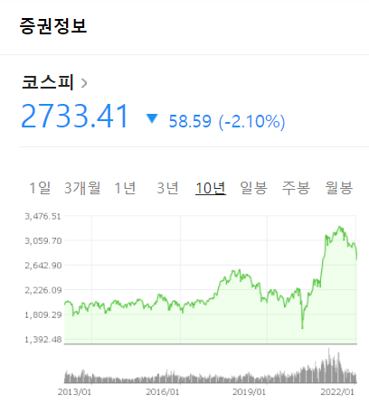

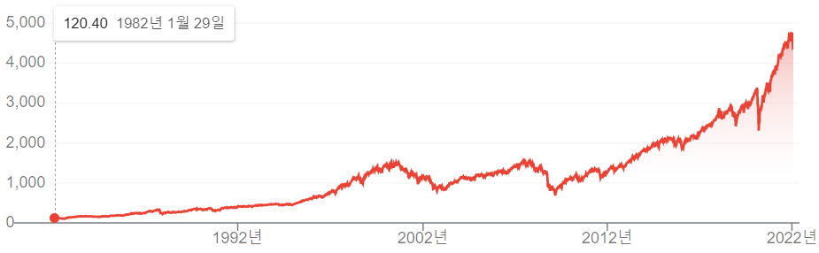

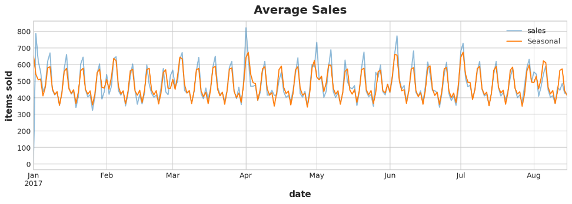

*생활 속 선 그래프 (코스피, S&P500, 일별 판매량)*

## 2. 기본 선 그래프
### 예시 1. 시간에 따른 값

```python
flights = sns.load_dataset('flights')          # 1949~1960 월별 항공 탑승객 수
flights_1960 = flights[flights['year'] == 1960]

sns.lineplot(data=flights_1960, x='month', y='passengers')
plt.title('1960년 월별 탑승객 수')
plt.show()
```

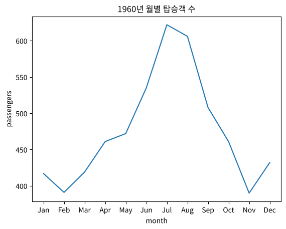

*실행 결과*

### 예시 2. 색상·마커·선 유형으로 구분

```python
fmri = sns.load_dataset('fmri')
sns.lineplot(data=fmri, x='timepoint', y='signal',
             hue='region', style='event',      # 색상: region, 선 유형: event
             markers=True, dashes=True)
plt.show()
```

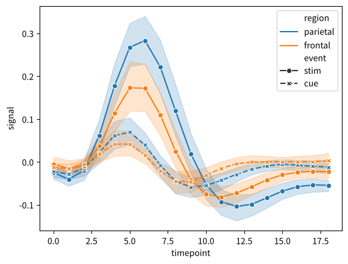

*실행 결과*

### 예시 3. 한 시점에 값이 여러 개일 때 → 면(신뢰구간)으로 표시

```python
sns.lineplot(data=flights, x='year', y='passengers')   # 같은 연도에 12개월 값 → 평균선 + 95% 신뢰구간
plt.show()

sns.lineplot(data=flights, x='year', y='passengers', errorbar='sd')   # 표준편차 범위로
plt.show()
```

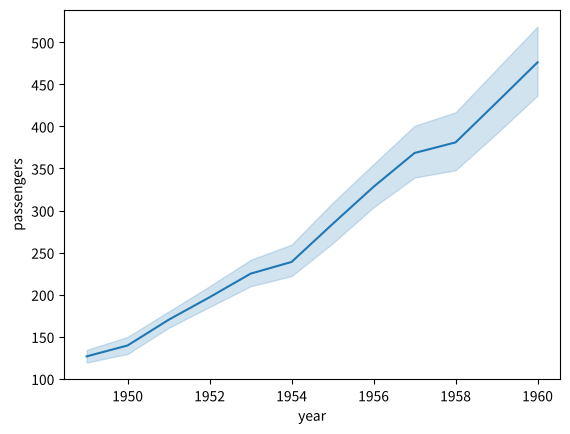

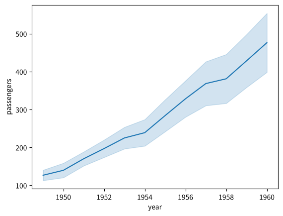

*실행 결과*

> `errorbar=None`으로 두면 면이 사라지고 평균선만 남음

### 같은 데이터, 다른 선 그래프 (seaborn 예제: timeseries_facets)

```python
sns.lineplot(data=flights, x='month', y='passengers', hue='year', palette='crest')
plt.show()

g = sns.relplot(data=flights, x='month', y='passengers',
                col='year', col_wrap=4, kind='line',
                height=2, aspect=1.5, linewidth=3)
g.set_xticklabels(rotation=90)
plt.show()
```

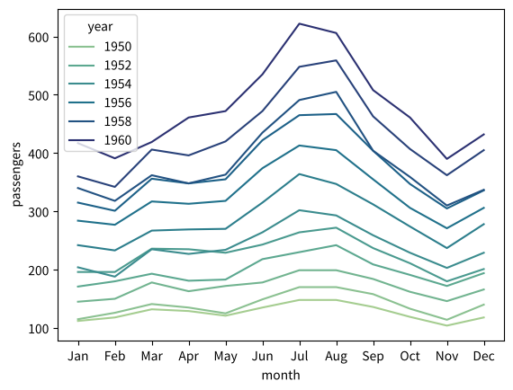

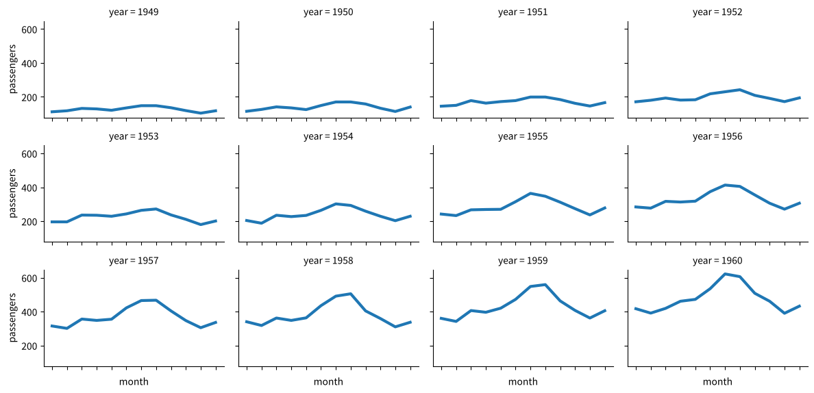

*실행 결과*

- 첫 번째: 연도별 선을 겹쳐 **해마다 커지는 계절성**을 비교
- 두 번째: 연도마다 따로 그려 **각 해의 모양**을 비교

### 예시 4. X축이 시간이 아닐 때
X축이 범주여도 순서나 비교의 의미가 있으면 선 그래프를 쓸 수 있음

```python
iris = sns.load_dataset('iris')
iris_mean = iris.groupby('species').mean().T            # 행: 속성, 열: 품종
iris_mean.plot(marker='o')
plt.ylabel('평균(cm)')
plt.show()
```

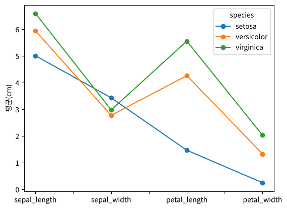

*실행 결과*

## 3. 누적 영역 그래프 (Stacked area)
- 시계열 여러 개를 차곡차곡 쌓아 빈 공간을 채움
- 한 시점의 세로 단면이 그 시점의 **구성(분포)**임
- 시간에 따라 이어진 누적 막대그래프로 볼 수도 있음

```python
pivot = flights.pivot(index='year', columns='month', values='passengers')
quarters = pd.DataFrame({
    '1분기': pivot[['Jan', 'Feb', 'Mar']].sum(axis=1),
    '2분기': pivot[['Apr', 'May', 'Jun']].sum(axis=1),
    '3분기': pivot[['Jul', 'Aug', 'Sep']].sum(axis=1),
    '4분기': pivot[['Oct', 'Nov', 'Dec']].sum(axis=1),
})
quarters.plot.area(alpha=0.8)
plt.ylabel('탑승객 수')
plt.show()
```

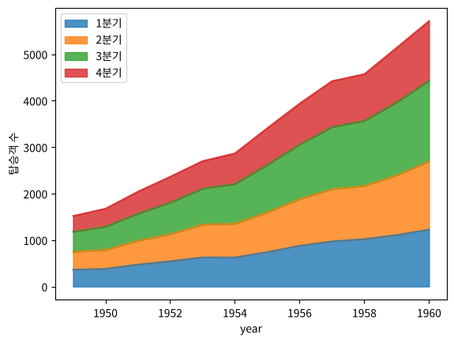

*실행 결과*

> seaborn에는 누적 영역 그래프 함수가 없어서 pandas(matplotlib)로 그림

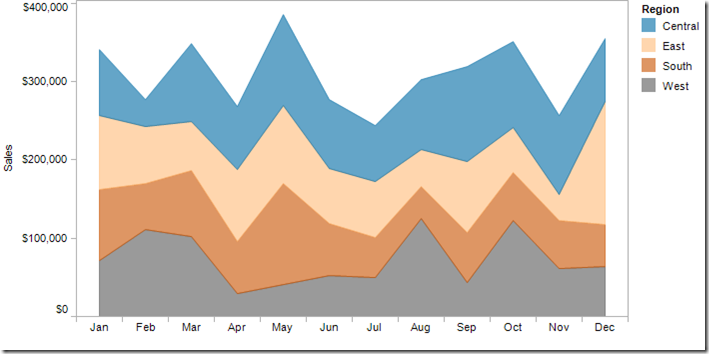

*누적 영역 그래프 예시*

## 4. 포인트 플롯 (Point plot)
- 범주별 **평균과 신뢰구간**을 점으로 찍고 선으로 이어, 범주 간의 변화를 보여 줌

```python
exercise = sns.load_dataset('exercise')
sns.pointplot(data=exercise, x='time', y='pulse', hue='kind',
              dodge=True, markers=['o', 's', '^'])
plt.show()
```

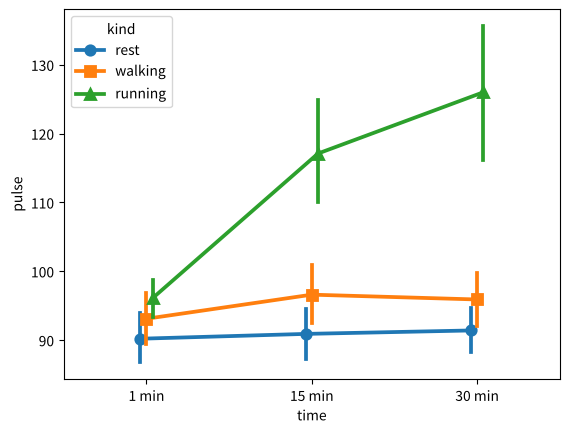

*실행 결과*

> seaborn `pointplot_anova` 예제를 단순화한 코드임

## 5. 선 그래프 계열 차트 (다른 문서에서 다룸)

| 차트 | 문서 |
|---|---|
| 회귀선, 잔차 그래프 | [07 산점도](/lectures/data-visualization/07_scatter-plot/) |
| 평행 좌표계 | [06 비교 시각화](/lectures/data-visualization/06_comparison-chart/) |
| Plotly 시계열 | [17 시계열·금융 차트](/lectures/data-visualization/17_plotly-timeseries/) |

## 정리

| 목적 | 함수 |
|---|---|
| 기본 선 그래프 | `sns.lineplot(x, y)` |
| 그룹별 색·선 유형 | `hue=`, `style=` |
| 그룹별 따로 그리기 | `sns.relplot(kind='line', col=...)` |
| 누적 영역 | `df.plot.area()` |
| 범주별 평균 비교 | `sns.pointplot()` |
