> 준비: [공통 준비 셀](/lectures/data-visualization/#common-setup) 실행

## 학습 목표
- 막대 그래프의 축 구성과 쓰임새를 설명할 수 있음
- 나쁜 막대 그래프와 좋은 막대 그래프를 구분하고 고칠 수 있음
- `barplot`, `countplot`, 누적 막대 그래프를 그릴 수 있음

## 1. 개념
- 수치를 **길이**로 표현한 막대를 늘어놓음
- **분절형 시간 시각화**: 시점별 막대로 시간에 따른 트렌드를 봄
- 축 구성
  - **가로축**: 시간 순서대로 정렬한 시점, 또는 **범주**
  - **세로축**: 값의 크기

```python
flights = sns.load_dataset('flights')
sns.barplot(data=flights[flights['year'] == 1960], x='month', y='passengers', color='steelblue')
plt.show()
```

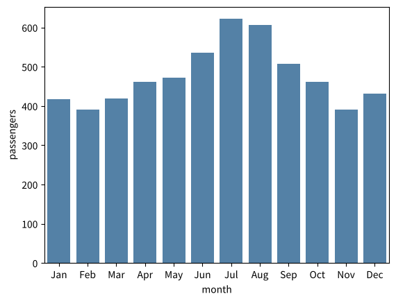

*실행 결과*

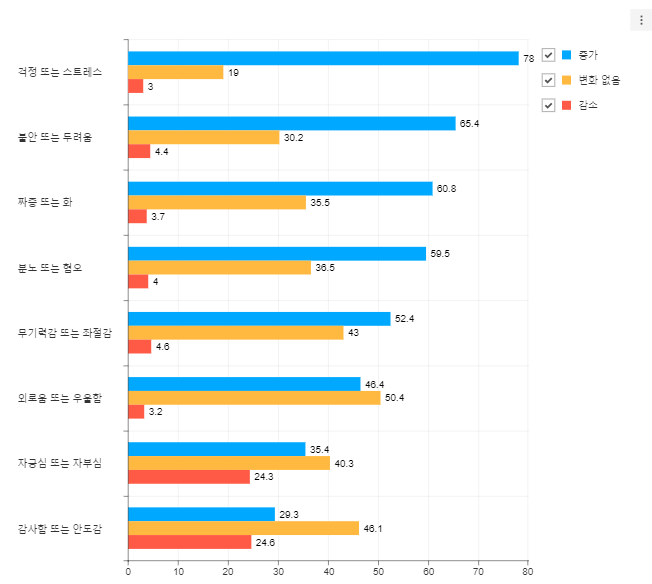

*막대 그래프 예시 (코로나19 이후 감정 변화)*

## 2. 한 범주에 값이 여러 개일 때 — 오차 막대
한 범주에 데이터가 여러 개면 막대 높이는 **평균**이 되고, 퍼진 정도를 보여 주는 **오차 막대(검은 선)**가 추가됨

```python
tips = sns.load_dataset('tips')
sns.barplot(data=tips, x='day', y='total_bill')                 # 기본: 평균 + 95% 신뢰구간
plt.show()
sns.barplot(data=tips, x='day', y='total_bill', errorbar='sd')  # 표준편차로
plt.show()
```

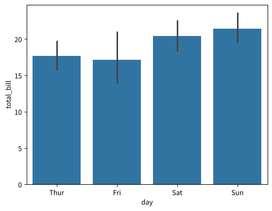

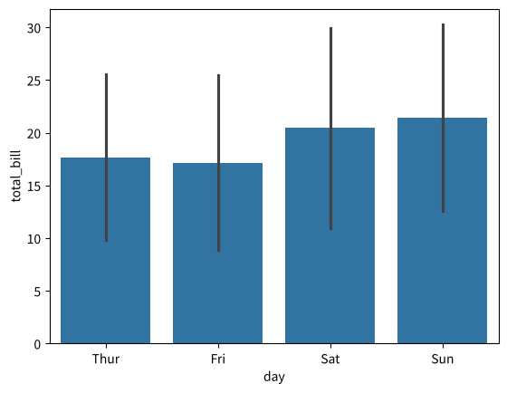

*실행 결과*

## 3. 색상으로 범주 구분

```python
sns.barplot(data=tips, x='day', y='total_bill', hue='sex')
plt.show()
```

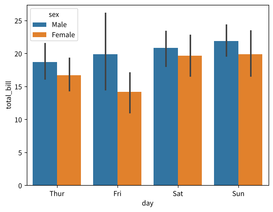

*실행 결과*

## 4. Bad vs Good 막대 그래프
### Bad (1) 막대 값의 차이가 작으면 비교하기 어렵음

```python
df = pd.DataFrame({'지점': ['A', 'B', 'C', 'D'], '만족도': [4.21, 4.25, 4.18, 4.30]})

fig, axes = plt.subplots(1, 3, figsize=(12, 3))
sns.barplot(data=df, x='지점', y='만족도', ax=axes[0]).set_title('Bad: 차이가 안 보임')
sns.barplot(data=df, x='지점', y='만족도', ax=axes[1]).set(ylim=(4.0, 4.4), title='Good: y축 범위 조정')
sns.pointplot(data=df, x='지점', y='만족도', ax=axes[2]).set_title('Good: 점 그래프로')
plt.tight_layout()
plt.show()
```

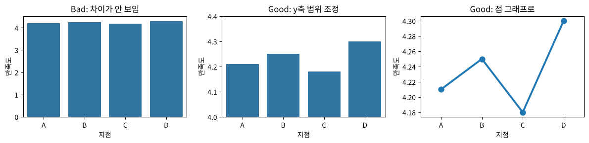

*실행 결과*

> y축을 0이 아닌 값에서 시작하면 차이가 **과장**됨. 축 범위를 꼭 표시하거나 점 그래프를 쓸 것 (ACCENT의 Truthfulness)

### Bad (2) 막대가 너무 많음
- 막대그래프의 가로축은 **범주형 데이터**임. 연속형 값이나 너무 많은 범주를 쓰면 읽을 수 없음
- 해결: 가로 막대로 바꾸고, 정렬하고, 상위 N개만 보여 줌

```python
mpg = sns.load_dataset('mpg')
top = mpg.groupby('name')['horsepower'].mean().sort_values(ascending=False).head(15)

sns.barplot(x=top.values, y=top.index, color='steelblue')   # 가로 막대 + 정렬 + 상위 15개
plt.xlabel('평균 마력')
plt.show()
```

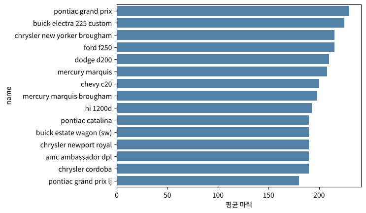

*실행 결과*

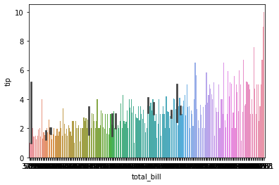

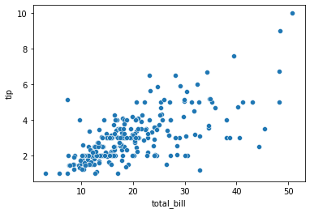

*Bad: 막대가 너무 많은 경우 vs 산점도로 바꾼 경우*

### Good (3) 색으로 강조하기
- 막대마다 색을 달리해 **특정 상태나 범위**를 강조함

```python
avg = tips.groupby('day', observed=True)['total_bill'].mean()
colors = ['tomato' if v == avg.max() else 'lightgray' for v in avg]

sns.barplot(x=avg.index, y=avg.values, hue=avg.index, palette=colors, dodge=False, legend=False)
plt.title('가장 높은 요일만 강조')
plt.show()
```

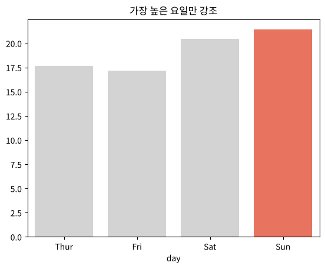

*실행 결과*

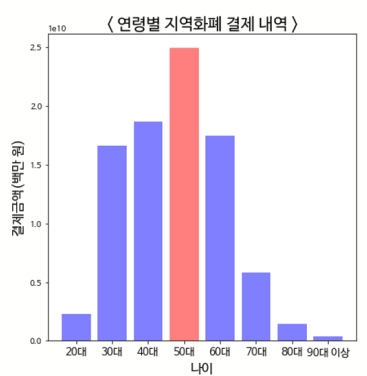

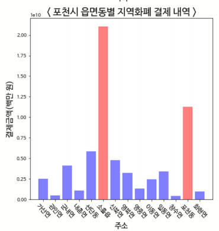

*Good: 색으로 강조한 막대그래프*

## 5. 카운트 플롯 (Count plot)
- 세로축이 **범주별 개수**임. 한 속성의 범주별 빈도를 볼 때 씀

```python
titanic = sns.load_dataset('titanic')
sns.countplot(data=titanic, x='class', hue='survived')
plt.show()
```

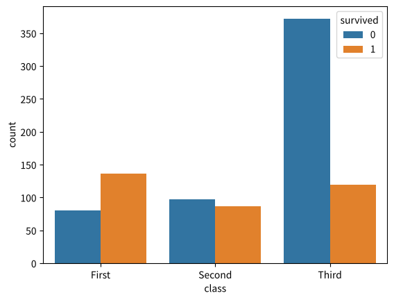

*실행 결과*

| | 히스토그램 | 카운트 플롯 |
|---|---|---|
| 가로축 | **연속형** 변수를 구간(bin)으로 나눔 | **범주형** 변수 |
| 세로축 | 구간별 도수 | 범주별 개수 |
| 함수 | `sns.histplot` | `sns.countplot` |

## 6. 누적 막대 그래프 (Stacked bar)
- 한 구간의 막대를 세부 항목으로 나눠 쌓음. **세부 항목으로 나뉘면서 전체 합도 의미가 있을 때** 씀
- 세부 항목은 색이나 질감으로 구분함
- 세부 항목이 너무 많으면 의미를 찾기 어렵음

```python
ct = pd.crosstab(titanic['class'], titanic['who'])
ct.plot.bar(stacked=True)
plt.ylabel('승객 수')
plt.xticks(rotation=0)
plt.show()

# seaborn으로: 범주별 개수를 쌓기
sns.histplot(data=titanic, x='class', hue='who', multiple='stack', shrink=0.8)
plt.show()
```

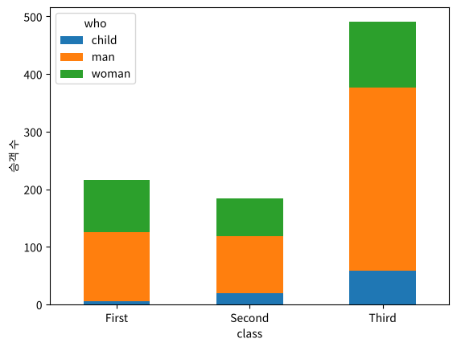

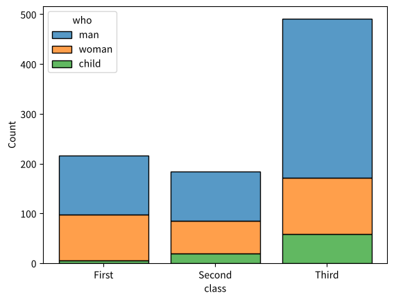

*실행 결과*

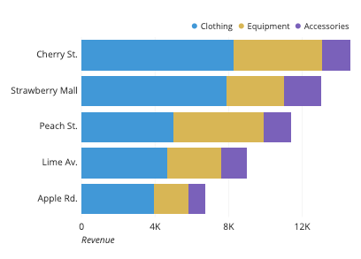

*누적 막대그래프 예시*

## 7. 참고: 분포를 보여 주는 그래프
막대 그래프 계열이지만 분포를 보여 주는 히스토그램, 박스 플롯, 바이올린 플롯은 [08 문서](/lectures/data-visualization/08_distribution/)에서 다룸

## 정리

| 목적 | 함수 |
|---|---|
| 범주별 평균 비교 | `sns.barplot(x, y)` |
| 범주별 개수 | `sns.countplot(x)` |
| 누적 | `df.plot.bar(stacked=True)`, `sns.histplot(multiple='stack')` |
| 막대 값 표시 | `ax.bar_label(ax.containers[0])` |

- 유의사항: 차이가 작으면 축이나 그래프 종류를 바꾸고, 범주가 많으면 가로 막대와 정렬을 쓰고, 강조할 막대는 색으로 표시함
