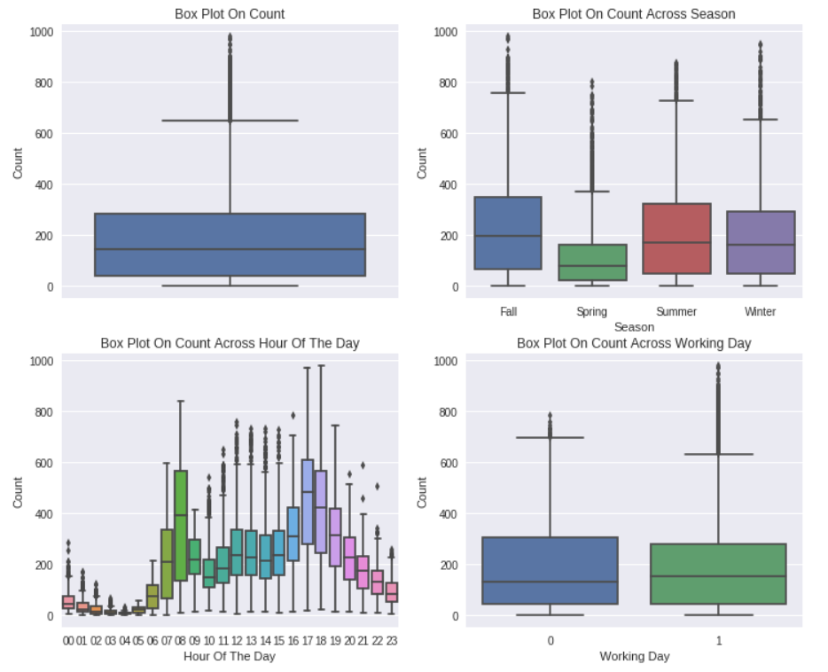
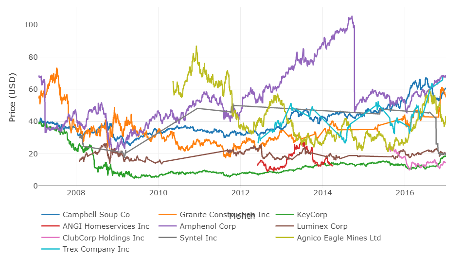
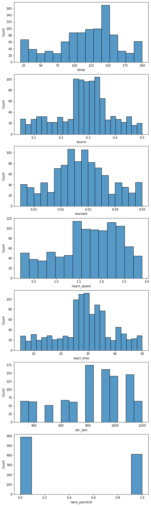

> 준비: [공통 준비 셀](/lectures/data-visualization/#common-setup) 실행

## 학습 목표
- EDA의 목적과 두 가지 방법(통계 지표 기반, 시각화 기반)을 설명할 수 있음
- 은나노 데이터로 두 방법을 직접 해 보고 차이를 비교할 수 있음

## 1. EDA란
> 분석할 데이터를 직관적으로 이해하기 위해 **시각화와 요약 정보**로 데이터의 분포를 파악하는 방법

EDA에서 하는 일
- **데이터 온전성 검사**: 타입, 범위, 개수가 기대와 맞는지
- **결측 데이터와 이상값 검사**
- **데이터 요약**

| 방법 | 수단 |
|---|---|
| 통계 지표 기반 | 개수, 평균, 표준편차, 최솟값, 사분위수, 최댓값 |
| 시각화 기반 | 선 그래프, 막대 그래프, 히스토그램, 파이 차트, 산점도, 박스 플롯 등 |





*시각화 기반 데이터 탐색 예시*

## 2. 실습 데이터: 은나노 생성 실험

| 열 | 의미 |
|---|---|
| `temp` | 온도 |
| `source` | 원료 물질 |
| `reactant` | 반응 물질 |
| `inject_speed` | 주입 속도 |
| `react_time` | 반응 시간 |
| `stir_rpm` | 회전 속도 |
| `nano_parcticle` | 은나노 생성 여부 (0/1) — 데이터의 열 이름 그대로 |

```python
# 실제 파일이 있으면: nano = pd.read_csv('은나노.csv')
# 아래는 앞 8행 샘플
nano = pd.DataFrame({
    'temp':           [100, 20, 40, 60, 40, 120, 100, 90],
    'source':         [0.29, 0.47, 0.21, 0.25, 0.15, 0.11, 0.05, 0.12],
    'reactant':       [0.013, 0.012, 0.045, 0.008, 0.044, 0.022, 0.035, 0.022],
    'inject_speed':   [1.4, 0.6, 1.7, 0.8, 1.2, 0.4, 2.6, 2.7],
    'react_time':     [24, 44, 13, 8, 38, 31, 39, 24],
    'stir_rpm':       [700, 400, 1000, 400, 700, 800, 900, 300],
    'nano_parcticle': [0, 0, 0, 0, 0, 1, 0, 0],
})
nano
```

> 앞 8행 표만 보면 "데이터는 몇 개? temp의 최댓값은? react_time은 평균 얼마나?" 같은 질문에 바로 답하기 어렵음
> 아래 수치(예: 평균 react_time 28.821)는 **전체 데이터** 기준이라 8행 샘플의 결과와 다름

## 3. 통계 지표 기반 EDA

```python
nano.shape            # (행, 열)
nano.info()           # 타입, 결측 아닌 값 개수
nano.isna().sum()     # 열별 결측값 개수
nano.describe()       # 개수, 평균, 표준편차, 최소, 사분위, 최대
nano['nano_parcticle'].value_counts()   # 범주(0/1) 비율
```

- 예(전체 데이터): temp는 20~200 사이에 분포하고, 평균 react_time은 28.821임
- 한계: 숫자만으로는 **분포의 모양**(몰림, 봉우리 개수, 이상치 위치)이 보이지 않음

## 4. 시각화 기반 EDA

```python
nano.hist(figsize=(12, 6), bins=10)     # 열마다 히스토그램
plt.tight_layout()
plt.show()
```

- 예(전체 데이터): temp는 25~200 사이에 퍼져 있고, source는 0.25~0.35 값이 많음



*은나노 전체 데이터의 열별 히스토그램*

```python
# 이상치 확인: 박스 플롯 (단위가 달라 표준화한 뒤 비교)
z = (nano - nano.mean()) / nano.std()
sns.boxplot(data=z.drop(columns='nano_parcticle'))
plt.ylabel('표준화 값')
plt.show()

# 변수 간 관계
sns.heatmap(nano.corr(), annot=True, fmt='.2f', cmap='coolwarm', center=0)
plt.show()
```

## 5. 두 방법 비교

| | 통계 지표 기반 | 시각화 기반 |
|---|---|---|
| 장점 | 정확한 수치, 빠름 | 분포 모양·이상치·관계가 한눈에 보임 |
| 한계 | 모양이 안 보임 (Datasaurus 문제) | 정확한 값은 따로 확인해야 함 |
| 결론 | **둘을 함께 씀** | |

## 정리
- EDA 순서: `shape`·`info()` → `isna()` → `describe()` → 히스토그램 → 박스 플롯 → 상관 히트맵
- 그래프별 사용법은 [13 seaborn 주요 그래프](/lectures/data-visualization/13_seaborn-charts/)에서 이어짐
