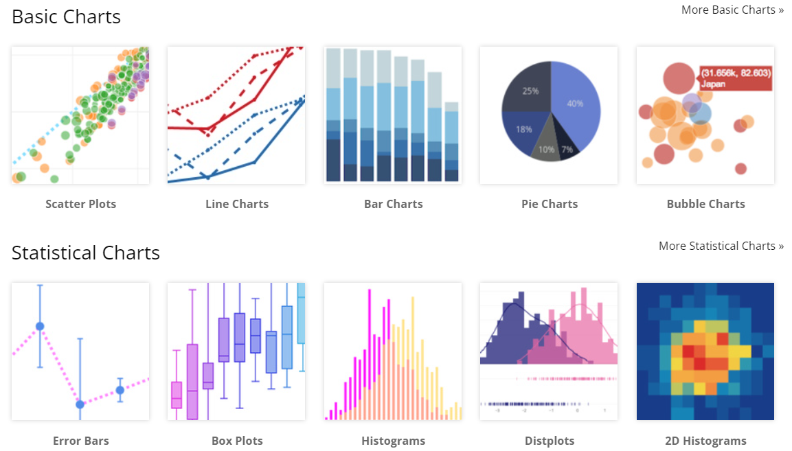
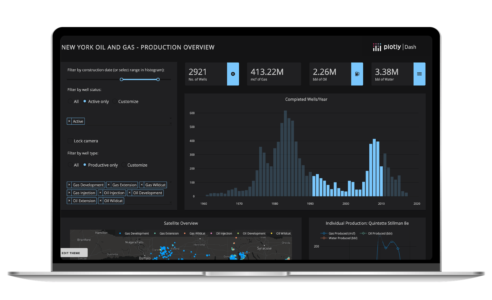
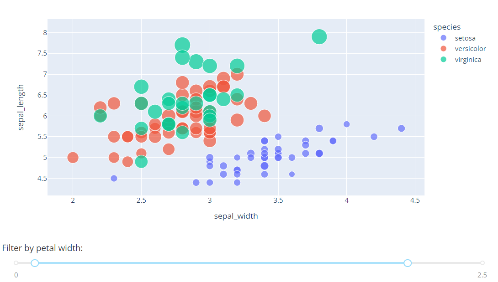
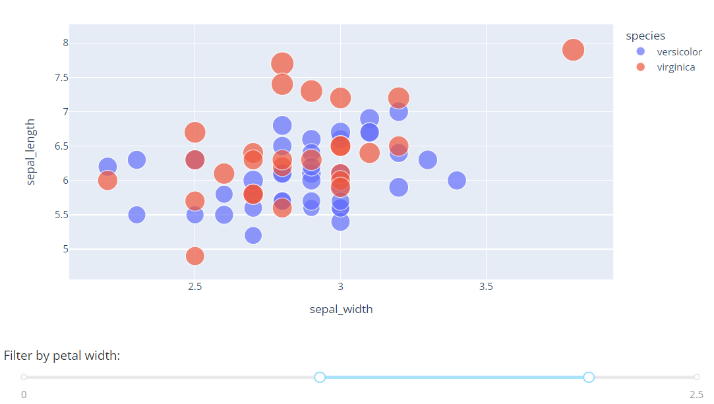

## 학습 목표
- Plotly의 특징과 서브모듈 구성을 설명할 수 있음
- Colab에서 Dash 앱을 실행할 수 있음

## 1. Plotly
- **대화형(interactive) 그래프 라이브러리**임
- 마우스 움직임이나 데이터 설정에 따라 **동적으로 바뀌는** 그래프를 만듬. 확대·축소, 툴팁, 범례 클릭으로 숨기기, 이미지 저장이 됨
- Colab에는 기본 설치되어 있고, `fig.show()`를 하면 셀 결과에 바로 나타남
- 공식 문서: https://plotly.com/python/



*Plotly 차트 갤러리*

## 2. 주요 구성

| 서브모듈 | 설명 |
|---|---|
| **Plotly Express** (`plotly.express`) | 시각화를 위한 **고수준(high-level)** 인터페이스. 한 줄로 그래프 생성 |
| **Graph Objects** (`plotly.graph_objects`) | **저수준(low-level)** 인터페이스. figure, trace, layout을 직접 설정 |
| **Subplots** (`plotly.subplots`) | 그래프 여러 개를 한 화면에 |
| **I/O** (`plotly.io`) | 그래프 저장·불러오기 |
| `plotly.colors` | 색상 값과 팔레트 |
| `plotly.data` | 내장 데이터셋 (`px.data.iris()` 등) |

```python
import plotly.express as px
import plotly.graph_objects as go

fig = px.scatter(px.data.iris(), x='sepal_width', y='sepal_length', color='species')
fig.show()

fig.write_html('iris.html')          # 인터랙티브 HTML로 저장
# fig.write_image('iris.png')        # 이미지 저장은 kaleido 필요: !pip install -q kaleido
```

### Express와 Graph Objects의 관계

```python
fig = px.bar(x=['A', 'B'], y=[1, 3])              # Express로 만든 것도
print(type(fig))                                   # plotly.graph_objects.Figure
fig.update_layout(title='Express + 세부 설정')      # Graph Objects 메서드로 다듬을 수 있음
fig.show()
```

## 3. Dash
- Python으로 **인터랙티브 대시보드**(웹 앱)를 만드는 프레임워크임. Plotly 그래프에 슬라이더, 드롭다운 같은 입력을 연결함
- 클릭으로 조작하는(point & click) 인터페이스를 줌
- 공식 문서: https://dash.plotly.com/



*Dash 대시보드 예시*

### 예제: petal_width 범위 슬라이더
슬라이더를 움직이면 그 범위의 데이터만 산점도에 동적으로 표시됨

```python
!pip install -q dash
```

```python
from dash import Dash, dcc, html, Input, Output
import plotly.express as px

df = px.data.iris()
app = Dash(__name__)

app.layout = html.Div([
    html.H4('Iris: petal_width 범위로 필터링'),
    dcc.Graph(id='scatter-plot'),
    html.P('Petal Width:'),
    dcc.RangeSlider(id='range-slider', min=0, max=2.5, step=0.1,
                    marks={0: '0', 2.5: '2.5'}, value=[0.5, 2]),
])

@app.callback(
    Output('scatter-plot', 'figure'),
    Input('range-slider', 'value'))
def update_bar_chart(slider_range):
    low, high = slider_range
    mask = (df['petal_width'] > low) & (df['petal_width'] < high)
    fig = px.scatter(df[mask], x='sepal_width', y='sepal_length',
                     color='species', size='petal_length',
                     hover_data=['petal_width'])
    return fig

app.run(jupyter_mode='inline')      # Colab 셀 안에 앱 표시
```





*슬라이더 범위에 따라 바뀌는 산점도*

> Colab에서 그대로 실행되도록 레이아웃과 실행 코드를 모두 포함했음
> - Dash 2.11 이상은 `jupyter_mode='inline'`으로 노트북 안에 바로 표시됨. 예전의 `jupyter-dash` 패키지는 필요 없음
> - 다시 실행할 때 포트가 이미 쓰이고 있다는 에러가 나면 `app.run(jupyter_mode='inline', port=8051)`처럼 포트를 바꿀 것

### 콜백의 동작

```
[RangeSlider value] ──Input──▶ update_bar_chart() ──Output──▶ [Graph figure]
```

- `Input`: 어떤 컴포넌트의 어떤 속성이 바뀌면 실행할지
- `Output`: 함수의 반환값을 어느 컴포넌트의 어떤 속성에 넣을지

## 정리

| 모듈 | 용도 |
|---|---|
| `plotly.express` | 빠른 그래프 (주로 이것) → [15 문서](/lectures/data-visualization/15_plotly-express/) |
| `plotly.graph_objects` | 세밀한 조정 → [16 문서](/lectures/data-visualization/16_plotly-pie-bubble/) |
| `plotly.subplots` | 여러 그래프 → [16 문서](/lectures/data-visualization/16_plotly-pie-bubble/) |
| Dash | 인터랙티브 웹 대시보드 |
