## 학습 목표
- Plotly Express의 주요 함수를 알고 쓸 수 있음
- long-form과 wide-form 데이터의 차이를 설명할 수 있음
- 막대 그래프에 텍스트와 패턴을 표시할 수 있음

## 1. 모듈 import와 주요 함수

```python
import plotly.express as px
```

| 함수 | 설명 | 함수 | 설명 |
|---|---|---|---|
| `px.scatter` | 산점도 | `px.pie` | 파이 차트 |
| `px.line` | 선 그래프 | `px.treemap` | 트리맵 |
| `px.bar` | 막대 그래프 | `px.funnel` | 퍼널 차트 |
| `px.violin` | 바이올린 플롯 | `px.parallel_coordinates` | 평행 좌표계 |
| `px.box` | 박스 플롯 | `px.area` | 영역 그래프 |
| `px.histogram` | 히스토그램 | `px.choropleth` | 단계구분도 |

## 2. 산점도
### 리스트로

```python
fig = px.scatter(x=[0, 1, 2, 3, 4], y=[0, 1, 4, 9, 16])
fig.show()
```

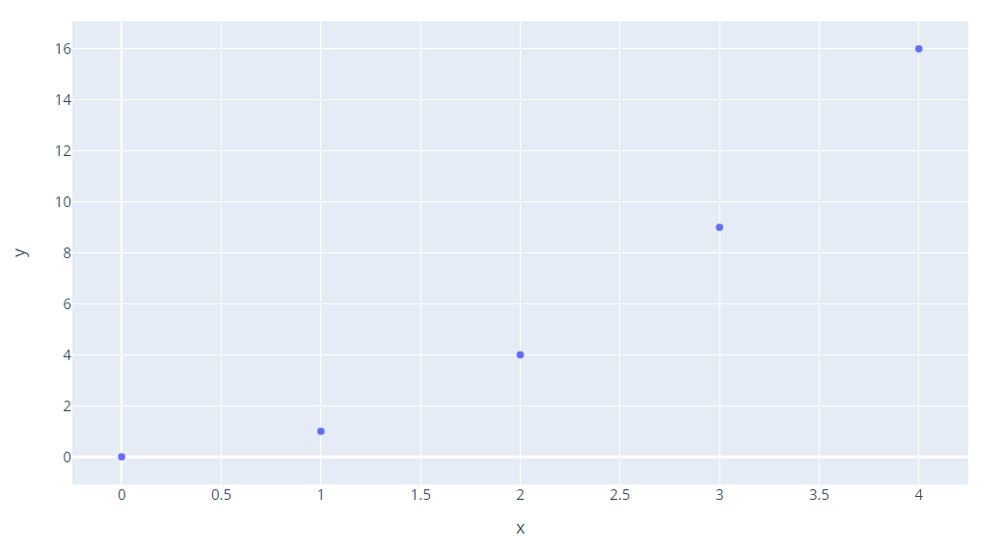

*실행 결과*

### DataFrame + 색·크기·툴팁

```python
df = px.data.iris()
fig = px.scatter(df, x='sepal_width', y='sepal_length',
                 color='species', size='petal_length',
                 hover_data=['petal_width'])
fig.show()
```

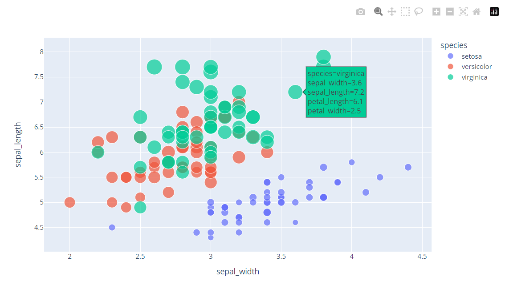

*실행 결과 (툴팁 표시)*

### 색 + 모양

```python
fig = px.scatter(df, x='sepal_width', y='sepal_length',
                 color='species', symbol='species')
fig.show()
```

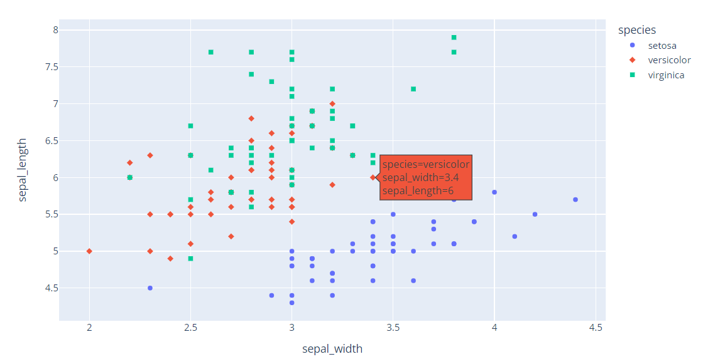

*실행 결과*

## 3. 선 그래프

```python
df = px.data.gapminder().query("continent == 'Oceania'")
fig = px.line(df, x='year', y='lifeExp', color='country')
fig.show()
```

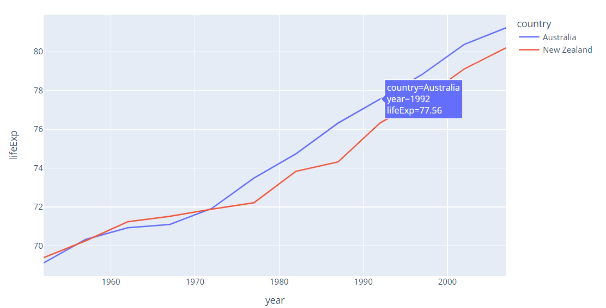

*실행 결과*

## 4. 막대 그래프
### 기본

```python
data_canada = px.data.gapminder().query("country == 'Canada'")
fig = px.bar(data_canada, x='year', y='pop')
fig.show()
```

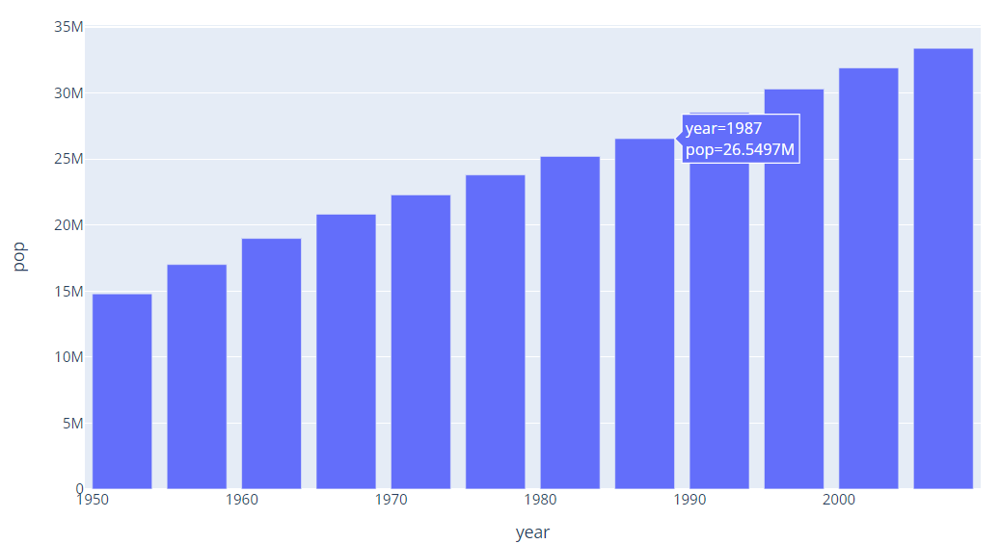

*실행 결과*

### long-form vs wide-form

| 형태 | 구조 | 예 |
|---|---|---|
| **long-form** | 한 행 = 관측값 하나. 범주가 **열 하나**에 들어 있음 | `nation, medal, count` |
| **wide-form** | 한 행 = 대상 하나. 범주가 **여러 열**로 펼쳐져 있음 | `nation, gold, silver, bronze` |

```python
long_df = px.data.medals_long()
long_df
fig = px.bar(long_df, x='nation', y='count', color='medal', title='Long-Form Input')
fig.show()
```

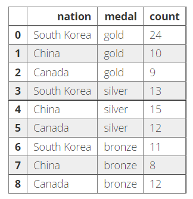

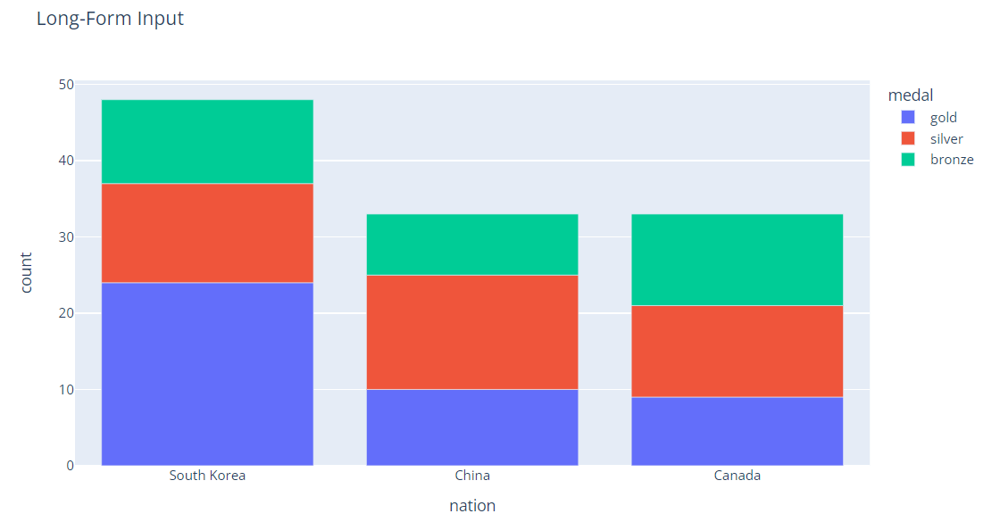

*long_df와 실행 결과*

```python
wide_df = px.data.medals_wide()
wide_df
fig = px.bar(wide_df, x='nation', y=['gold', 'silver', 'bronze'], title='Wide-Form Input')
fig.show()
```

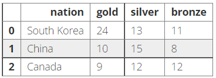

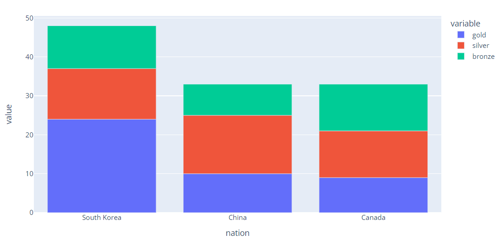

*wide_df와 실행 결과*

> 두 그래프는 같음. wide-form은 `y=`에 열 목록을 주면 되고, 서로 바꾸려면 `melt()`(wide → long)와 `pivot()`(long → wide)을 씀

### histogram으로 집계한 막대
`px.histogram`은 x 범주별로 y를 **집계**(기본은 합계)해 막대를 그림

```python
df = px.data.tips()
fig = px.histogram(df, x='sex', y='total_bill',
                   color='smoker', barmode='group', height=400)   # 합계
fig.show()

fig = px.histogram(df, x='sex', y='total_bill',
                   color='smoker', barmode='group',
                   histfunc='avg', height=400)                    # 평균
fig.show()
```

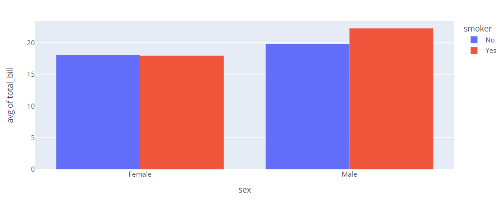

*실행 결과 (평균)*

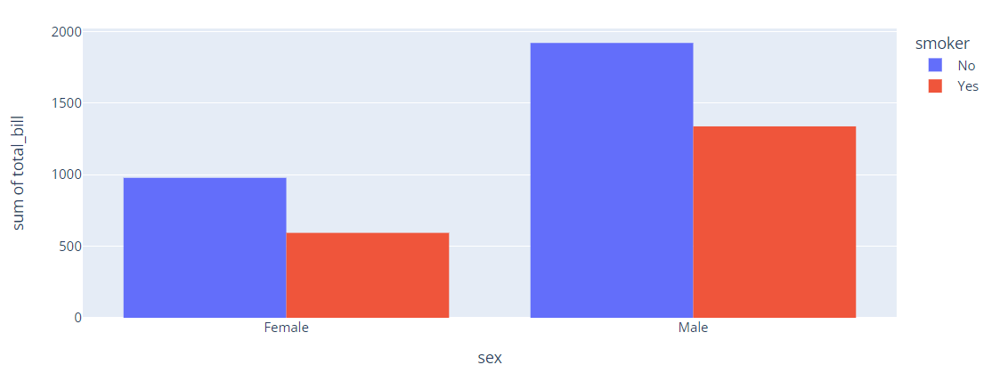

*실행 결과 (합계)*

| `barmode` | 모양 |
|---|---|
| `'relative'` (기본) | 쌓기 |
| `'group'` | 나란히 |
| `'overlay'` | 겹치기 |

## 5. 막대 그래프 꾸미기
### 텍스트 표시

```python
df = px.data.medals_long()
fig = px.bar(df, x='medal', y='count', color='nation', text_auto=True)
fig.show()
```

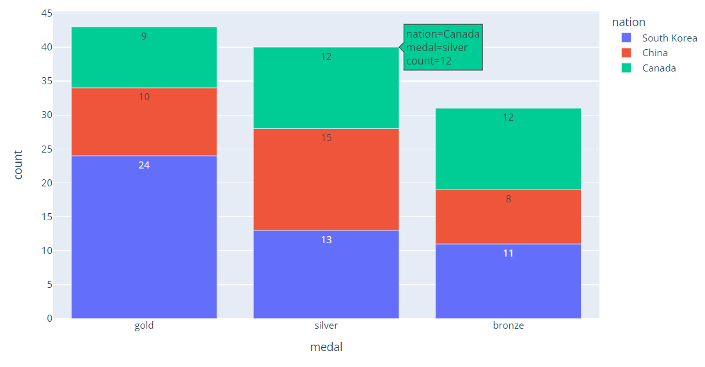

*실행 결과*

> `text_auto=True`는 **막대 안에 값**을 표시함. `False`로 바꾸면 막대 위의 값만 사라지고, 축 레이블은 그대로임

### 텍스트 크기·위치·각도 조절

```python
df = px.data.gapminder().query("continent == 'Europe' and year == 2007 and pop > 2.e6")
fig = px.bar(df, y='pop', x='country', text_auto='.2s',       # 유효숫자 2자리 (예: 82M)
             title='Controlled text sizes, positions and angles')
fig.update_traces(textfont_size=12, textangle=0,
                  textposition='outside', cliponaxis=False)
fig.show()
```

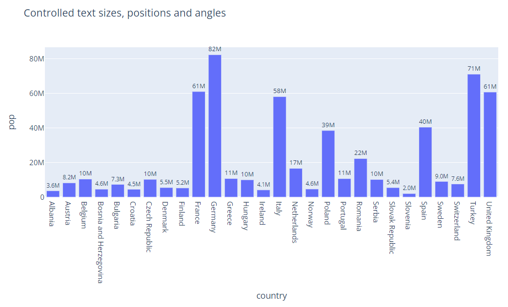

*실행 결과*

### 패턴 표시
흑백으로 인쇄하거나 색 구분이 어려운 사람을 위해 색과 함께 **무늬**로도 구분함

```python
df = px.data.medals_long()
fig = px.bar(df, x='medal', y='count', color='nation',
             pattern_shape='nation', pattern_shape_sequence=['.', 'x', '+'])
fig.show()
```

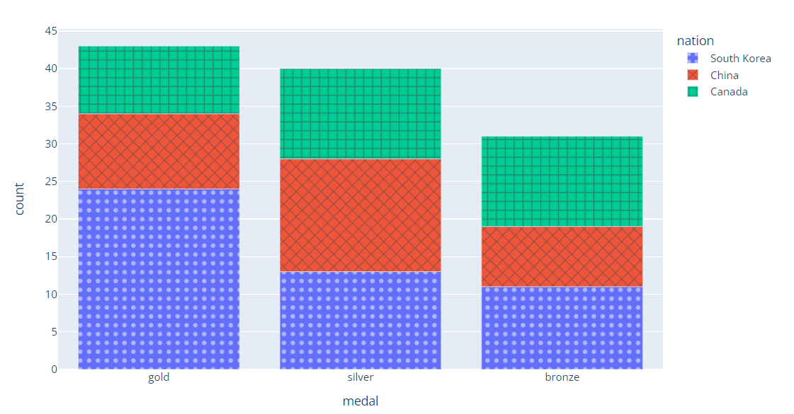

*실행 결과*

## 6. 그래프 공통 설정

```python
fig.update_layout(title='제목', xaxis_title='X축 이름', yaxis_title='Y축 이름',
                  font=dict(size=14), legend_title='범례', template='plotly_white')
fig.update_xaxes(tickangle=45)
fig.show()
```

## 정리

| 그래프 | 함수 | 자주 쓰는 인자 |
|---|---|---|
| 산점도 | `px.scatter` | `color`, `size`, `symbol`, `hover_data` |
| 선 | `px.line` | `color` |
| 막대 | `px.bar` | `color`, `text_auto`, `pattern_shape` |
| 집계 막대 | `px.histogram` | `histfunc`, `barmode` |
