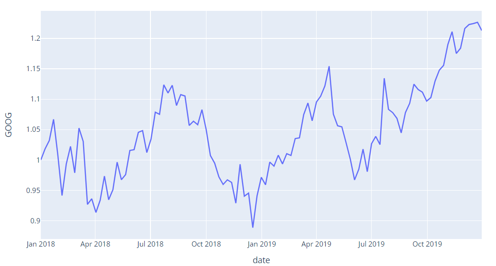
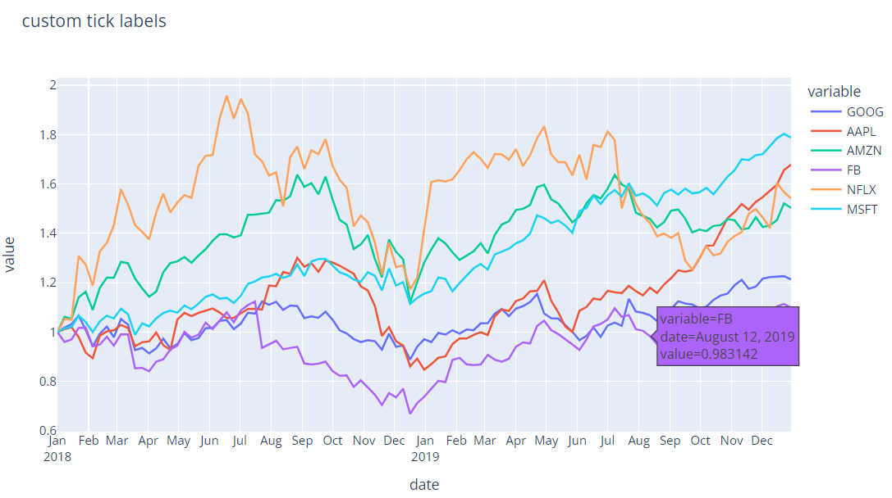
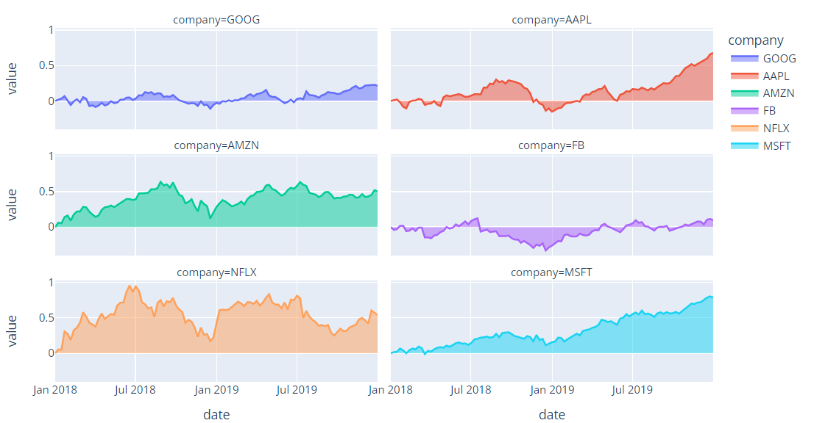
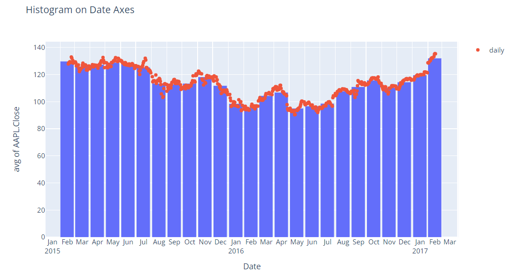
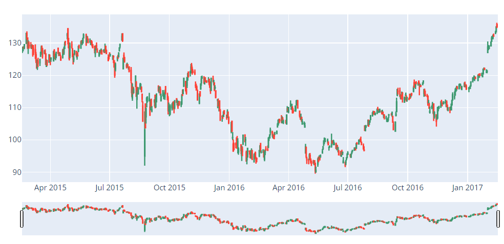
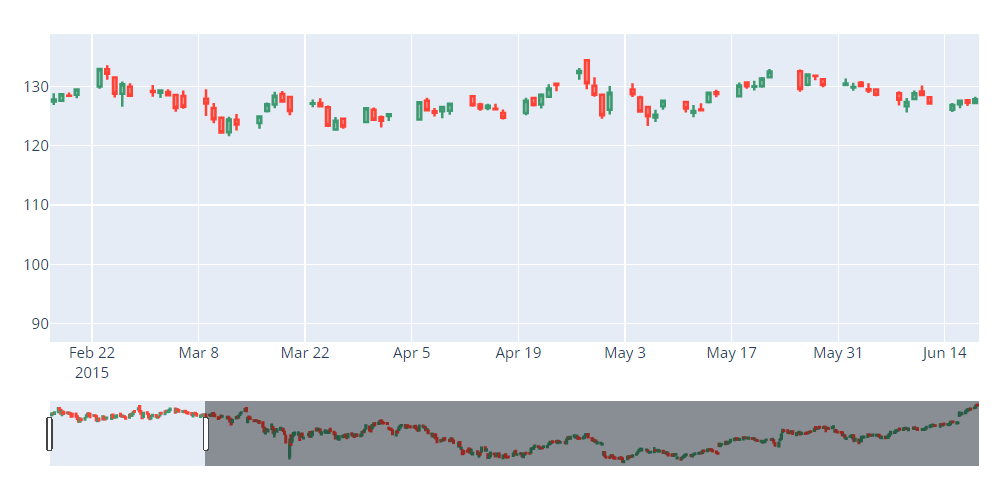
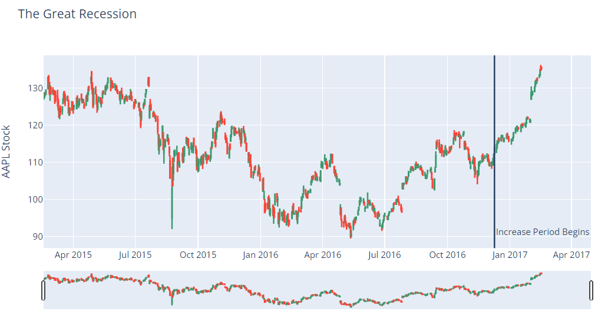

## 학습 목표
- 시계열 데이터를 선 그래프로 그리고 날짜 축을 설정할 수 있음
- facet, histogram + scatter 조합을 쓸 수 있음
- 캔들스틱 차트를 만들고 annotation을 추가할 수 있음

```python
import pandas as pd
import plotly.express as px
import plotly.graph_objects as go
```

## 1. 시계열 데이터
### 기본

```python
df = px.data.stocks()           # 2018~2019 주간 주가 (2018-01-01 = 1로 정규화)
fig = px.line(df, x='date', y='GOOG')
fig.show()
```



*실행 결과*

### 여러 종목 + 눈금 레이블 설정

```python
fig = px.line(df, x='date', y=df.columns,
              hover_data={'date': '|%B %d, %Y'},      # 툴팁 날짜 형식
              title='custom tick labels')
fig.update_xaxes(dtick='M1', tickformat='%b\n%Y')    # 1개월 간격, "Jan\n2018" 형식
fig.show()
```



*실행 결과*

| 설정 | 의미 |
|---|---|
| `dtick='M1'` | 눈금 간격 1개월 (`'M3'`은 분기) |
| `tickformat='%b\n%Y'` | 월 약칭 + 줄바꿈 + 연도 |
| `hover_data={'date': '\|%B %d, %Y'}` | 툴팁에 "January 01, 2018" 형식 |

> `y=df.columns`는 `date` 열까지 포함함. 깔끔하게 하려면 `y=df.columns[1:]`처럼 종목 열만 지정할 것

## 2. Facetted area — 종목별로 나눠 그리기

```python
df = px.data.stocks(indexed=True) - 1      # 날짜 인덱스, 기준 대비 수익률(0 기준)
fig = px.area(df, facet_col='company', facet_col_wrap=2)
fig.show()
```



*실행 결과*

## 3. Histogram + Scatter — 월평균과 일별 값을 함께

```python
df = pd.read_csv('https://raw.githubusercontent.com/plotly/datasets/master/finance-charts-apple.csv')

fig = px.histogram(df, x='Date', y='AAPL.Close', histfunc='avg',
                   title='Histogram on Date Axes')
fig.update_traces(xbins_size='M1')                            # 월 단위 막대 (월평균)
fig.update_xaxes(showgrid=True, ticklabelmode='period', dtick='M1', tickformat='%b\n%Y')
fig.update_layout(bargap=0.1)
fig.add_trace(go.Scatter(mode='markers', x=df['Date'], y=df['AAPL.Close'], name='daily'))
fig.show()
```



*실행 결과*

> `ticklabelmode='period'`: 눈금 레이블을 구간의 **가운데**에 둠 (월 막대 가운데에 월 이름)

## 4. Candlestick (캔들스틱)
- 하루의 시가(open), 고가(high), 저가(low), 종가(close)를 막대 하나로 보여 줌
- 몸통: 시가~종가 / 꼬리: 고가~저가 / 색: 상승(초록), 하락(빨강)

```python
df = pd.read_csv('https://raw.githubusercontent.com/plotly/datasets/master/finance-charts-apple.csv')

fig = go.Figure(data=[go.Candlestick(x=df['Date'],
                                     open=df['AAPL.Open'],
                                     high=df['AAPL.High'],
                                     low=df['AAPL.Low'],
                                     close=df['AAPL.Close'])])
fig.show()
```





*실행 결과와 range slider로 기간을 좁힌 화면*

- 아래쪽 **range slider**를 움직이면 보이는 기간이 바뀜
- 필요 없으면 끔: `fig.update_layout(xaxis_rangeslider_visible=False)`

> 이 코드에서는 쓰지 않으므로 `from datetime import datetime`을 import하지 않았음

## 5. annotation 추가
특정 날짜에 세로선과 설명 텍스트를 넣음

```python
fig.update_layout(
    title='The Great Recession',
    yaxis_title='AAPL Stock',
    shapes=[dict(
        x0='2016-12-09', x1='2016-12-09', y0=0, y1=1,
        xref='x', yref='paper', line_width=2)],
    annotations=[dict(
        x='2016-12-09', y=0.05, xref='x', yref='paper',
        showarrow=False, xanchor='left',
        text='Increase Period Begins')]
)
fig.show()
```



*실행 결과*

| 설정 | 의미 |
|---|---|
| `xref='x'` | x 좌표를 **데이터 값**(날짜)으로 |
| `yref='paper'` | y 좌표를 **그래프 영역 비율**(0=아래, 1=위)로 |
| `shapes` | 선, 사각형 등 도형 |
| `annotations` | 텍스트 (화살표 선택 가능) |

> 예제 제목 'The Great Recession'(2008년 금융위기)은 plotly 공식 예제에서 가져온 것으로, 2016-12-09 표시와는 관계가 없음. 수업에서는 내용에 맞게 제목을 바꿔 쓸 것

### 간단한 방법: `add_vline`

```python
fig.add_vline(x='2016-12-09', line_width=2, line_dash='dash')
fig.add_annotation(x='2016-12-09', y=0.95, yref='paper', text='Increase Period Begins',
                   showarrow=False, xanchor='left')
fig.show()
```

## 정리

| 목적 | 코드 |
|---|---|
| 시계열 선 | `px.line(df, x='date', y=...)` |
| 날짜 눈금 | `update_xaxes(dtick='M1', tickformat=...)` |
| 그룹별 분할 | `px.area(facet_col=..., facet_col_wrap=...)` |
| 기간 평균 막대 | `px.histogram(histfunc='avg')` + `xbins_size='M1'` |
| 캔들스틱 | `go.Candlestick(open, high, low, close)` |
| 주석 | `update_layout(shapes=..., annotations=...)`, `add_vline` |
