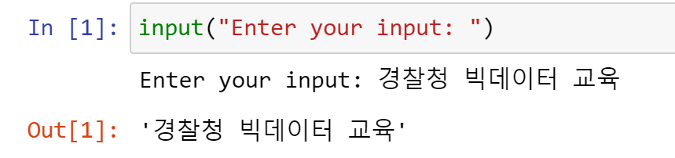
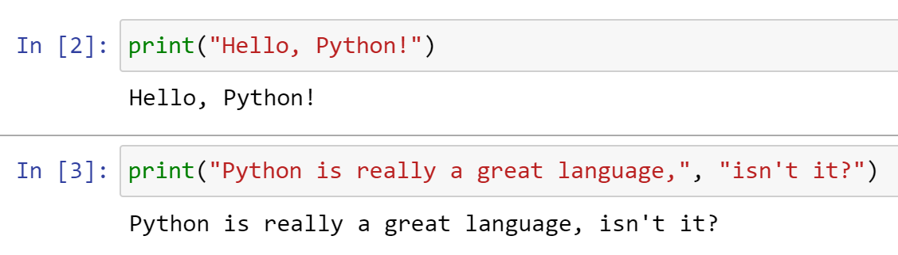
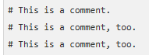
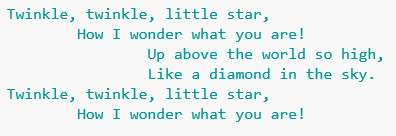

## 학습 목표
- `input()`으로 값을 입력받고 `print()`로 출력할 수 있음
- 여러 줄 문자열, 주석, 들여쓰기 규칙을 설명할 수 있음

## 1. input — 입력 함수
입력창에서 한 줄을 받아 **문자열(str)**로 돌려줌

```python
value = input("Enter your input: ")
print(value)
```

> 숫자를 입력해도 결과는 문자열임. 계산에 쓰려면 `int()`나 `float()`으로 바꿔야 함 ([03 문서](/lectures/python/03_numbers-strings-variables/))



*input() 실행 결과*

## 2. print — 출력 함수
- 가장 간단한 출력 방법임. 넘긴 값을 문자열로 바꿔 화면에 씀
- 쉼표로 여러 값을 나열하면 공백으로 이어서 출력함

```python
print("Hello, Python!")
print("Python is really a great language,", "isn't it?")
```



*print() 실행 결과*

## 3. 여러 줄 출력
큰따옴표 세 개(`"""`)나 작은따옴표 세 개(`'''`)로 여러 줄 문자열을 만듬

```python
a = """Lorem ipsum dolor sit amet,
consectetur adipiscing elit,
sed do eiusmod tempor incididunt
ut labore et dolore magna aliqua."""
print(a)

b = '''Lorem ipsum dolor sit amet,
consectetur adipiscing elit,
sed do eiusmod tempor incididunt
ut labore et dolore magna aliqua.'''
print(b)
```

## 4. 주석 (Comments)
`#` 뒤의 내용은 실행되지 않음

```python
# 이 줄 전체가 주석입니다
print("Hello")  # 코드 뒤에도 주석을 달 수 있습니다
```



*# 주석*

> Colab에서는 `Ctrl + /`로 여러 줄을 한 번에 주석 처리할 수 있음

## 5. 들여쓰기 (Indentation)
- 파이썬은 중괄호 `{}` 대신 **들여쓰기로 코드 블록**을 구분함
- 조건문, 반복문, 함수, 클래스 모두 `:` 뒤 다음 줄부터 들여씀. 보통 공백 4칸임

```python
score = 85
if score >= 80:
    print("합격")       # if 블록
    print("축하합니다")  # 같은 블록
print("종료")           # 블록 밖
```

> 들여쓰기가 맞지 않으면 `IndentationError`가 남

## 실습

### [Exercise #1] 형식에 맞춰 출력하기
아래 결과가 나오도록 프로그램을 작성

```
Twinkle, twinkle, little star,
	How I wonder what you are!
		Up above the world so high,
		Like a diamond in the sky.
Twinkle, twinkle, little star,
	How I wonder what you are!
```



*Exercise #1 출력 결과*

<details markdown="1">
<summary>정답 예시</summary>

```python
print("Twinkle, twinkle, little star, \n\tHow I wonder what you are! \n\t\tUp above the world so high, \n\t\tLike a diamond in the sky. \nTwinkle, twinkle, little star, \n\tHow I wonder what you are!")
```

- `\n`: 줄바꿈, `\t`: 탭
- `"""` 여러 줄 문자열로 써도 같은 결과가 나옴
</details>

## 정리

| 문법 | 핵심 |
|---|---|
| `input()` | 입력값은 항상 문자열 |
| `print()` | 쉼표로 여러 값 출력 |
| `"""`, `'''` | 여러 줄 문자열 |
| `#` | 주석 |
| 들여쓰기 | 코드 블록을 구분 (공백 4칸) |
