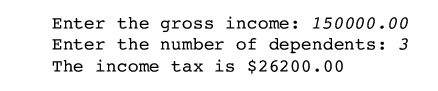

## 학습 목표
- 숫자형의 종류와 산술 연산자, 연산 순서를 이해함
- 문자열의 연결·반복·인덱싱·슬라이싱을 쓸 수 있음
- 변수에 값을 저장하고 계산에 쓸 수 있음

## 1. 숫자형 (Numbers)

| 타입 | 의미 | 예 |
|---|---|---|
| `int` | 정수 | `12` |
| `float` | 실수(소수) | `3.14` |
| `complex` | 복소수 | `3+7j` |

### 산술 연산자

| 연산자 | 의미 | 예 | 결과 |
|---|---|---|---|
| `+` `-` `*` `/` | 덧셈, 뺄셈, 곱셈, 나눗셈 | `7 / 2` | `3.5` |
| `//` | 몫 | `7 // 2` | `3` |
| `%` | 나머지 | `7 % 2` | `1` |
| `**` | 거듭제곱 | `2 ** 3` | `8` |

### 연산 순서
- `**` → `*` `/` `//` `%` → `+` `-` 순서로 계산함
- 괄호로 순서를 바꿀 수 있음

```python
print(1 + 3 * 4)    # 13
print((1 + 3) * 4)  # 16
```

## 2. 문자열 (Strings)
작은따옴표와 큰따옴표는 같은 뜻임

```python
"hello" + "world"   # 'helloworld'      연결
"hello" * 3         # 'hellohellohello' 반복
"hello"[0]          # 'h'               인덱싱 (0부터 시작)
"hello"[-1]         # 'o'               끝에서부터
"hello"[1:4]        # 'ell'             슬라이싱 (끝 번호는 포함 안 함)

len("hello")        # 5                 길이
"hello" < "jello"   # True              사전순 비교
"e" in "hello"      # True              포함 여부
```

### 특수 문자와 따옴표

```python
print("escapes: \n 줄바꿈, \t 탭")
'single quotes'
"""triple quotes"""
r"C:\new\folder"    # raw string: \를 그대로 출력
```

## 3. 변수 (Variables)
- 값을 저장해 두었다가 나중에 다시 쓰는, **이름 붙은 메모리 공간**임
- `=`는 "같다"가 아니라 **오른쪽 값을 왼쪽 변수에 저장(대입)**한다는 뜻임

```python
x = 5
gpa = 3.14
print(x + 4)          # 9

name = "Andrew"
print("Hello", name)  # Hello Andrew
```

### 타입 변환
`input()`의 결과는 문자열이므로 계산 전에 숫자로 바꿈

```python
age = int(input("나이: "))       # 정수로
height = float(input("키(m): ")) # 실수로
```

## 실습

### [Exercise #2] 100살이 되는 해
이름과 나이를 입력받아, 그 사람이 100살이 되는 연도를 알려 주는 메시지를 출력

<details markdown="1">
<summary>정답 예시</summary>

```python
from datetime import date

name = input("이름: ")
age = int(input("나이: "))
year = date.today().year + (100 - age)
print(f"{name}님은 {year}년에 100살이 됩니다.")
```

</details>

### [Exercise #3] BMI 계산
체중(kg)과 키(m)를 입력받아 BMI를 출력. `BMI = 체중 / (키 * 키)`

<details markdown="1">
<summary>정답 예시</summary>

```python
weight = float(input("체중(kg): "))
height = float(input("키(m): "))
bmi = weight / (height * height)   # 괄호 필수: w / h*h 로 쓰면 (w/h)*h 가 됨
print(f"BMI: {bmi:.2f}")
```

</details>

### [Exercise #4] 소득세 계산
아래 세법에 따라 소득세를 계산
- 세율: 일괄 20%
- 기본공제: $10,000
- 부양가족 1명당 추가공제: $3,000



*Exercise #4 실행 예시*

<details markdown="1">
<summary>정답 예시</summary>

```python
TAX_RATE = 0.20
STANDARD_DEDUCTION = 10000.0
DEPENDENT_DEDUCTION = 3000.0

gross_income = float(input("총소득: "))
num_dependents = int(input("부양가족 수: "))

taxable_income = gross_income - STANDARD_DEDUCTION - DEPENDENT_DEDUCTION * num_dependents
income_tax = max(taxable_income, 0) * TAX_RATE
print(f"소득세: ${income_tax:,.2f}")
```

</details>

## 정리
- 숫자: `int`, `float`, `complex` / 연산 순서는 `**` → `* / // %` → `+ -`
- 문자열: `+` 연결, `*` 반복, `[i]` 인덱싱, `[a:b]` 슬라이싱
- 변수: `=`로 대입 / 입력값은 `int()`, `float()`으로 변환
