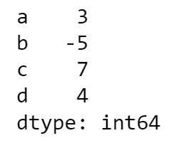

## 학습 목표
- Series와 DataFrame의 구조를 설명할 수 있음
- 딕셔너리와 2D 리스트로 DataFrame을 만들 수 있음
- CSV·Excel 파일을 읽고 저장할 수 있음

## 1. Series — 1차원
어떤 타입이든 담을 수 있는, **레이블(인덱스)이 붙은 1차원 배열**임

```python
import pandas as pd

s = pd.Series([3, -5, 7, 4], index=['a', 'b', 'c', 'd'])
s
# a    3
# b   -5
# c    7
# d    4
```



*Series 출력*

## 2. DataFrame — 2차원
행과 열에 레이블이 붙은 **2차원 표**임. 열마다 데이터 타입이 달라도 됨

|   | Country | Capital | Population |
|---|---|---|---|
| 0 | Belgium | Brussels | 11190846 |
| 1 | India | New Delhi | 1303171035 |
| 2 | Brazil | Brasilia | 207847528 |

> DataFrame의 각 열은 하나의 Series임

### 딕셔너리로 만들기
키가 열 이름, 값(리스트)이 열 데이터가 됨

```python
data = {
    'Country': ['Belgium', 'India', 'Brazil'],
    'Capital': ['Brussels', 'New Delhi', 'Brasilia'],
    'Population': [11190846, 1303171035, 207847528]
}
df = pd.DataFrame(data, columns=['Country', 'Capital', 'Population'])
df
```

### 2D 리스트로 만들기
안쪽 리스트 하나가 한 행임

```python
data = [['Jan', 58, 42, 74, 22, 2.95],
        ['Feb', 61, 45, 78, 26, 3.02],
        ['Mar', 65, 48, 84, 25, 2.34],
        ['Apr', 67, 50, 92, 28, 1.02]]
df = pd.DataFrame(data, index=[0, 1, 2, 3],
                  columns=['month', 'avg_high', 'avg_low',
                           'record_high', 'record_low', 'avg_precipitation'])
df
```

## 3. 파일 읽기·쓰기
> 파일 경로는 [00 문서](/lectures/python/00_colab/)의 드라이브 마운트와 `%cd` 설정을 따름

### 읽기

```python
df = pd.read_csv('file.csv')
df = pd.read_csv('file.csv', header=None, nrows=5, sep='\t')  # 헤더 없음, 5행만, 탭 구분
df = pd.read_excel('file.xlsx')
df = pd.read_excel('file.xlsx', sheet_name='Sheet1')
```

| 옵션 | 의미 |
|---|---|
| `header=None` | 첫 행을 열 이름이 아닌 데이터로 읽기 |
| `nrows=5` | 앞 5행만 읽기 |
| `sep` (= `delimiter`) | 구분자 지정 (`','`, `'\t'` 등) |
| `encoding` | 문자 인코딩 (아래 팁 참고) |

> **한글 CSV 팁**: 공공데이터 CSV는 `cp949`로 저장된 경우가 많음. `UnicodeDecodeError`가 나면 다음처럼 읽을 것
> ```python
> df = pd.read_csv('file.csv', encoding='cp949')
> ```

### 쓰기

```python
df.to_csv('myDataFrame.csv', index=False)                   # 인덱스 빼고 저장
df.to_csv('myDataFrame.csv', index=False, encoding='utf-8-sig')  # 엑셀에서 한글 안 깨짐
df.to_excel('myDataFrame.xlsx', sheet_name='Sheet1')
```

## 정리

| 구분 | Series | DataFrame |
|---|---|---|
| 차원 | 1차원 | 2차원 |
| 구성 | 인덱스 + 값 | 인덱스 + 여러 열(Series) |
| 생성 | `pd.Series(list, index=...)` | `pd.DataFrame(dict 또는 2D list)` |

- 읽기: `pd.read_csv()`, `pd.read_excel()` / 쓰기: `df.to_csv()`, `df.to_excel()`
