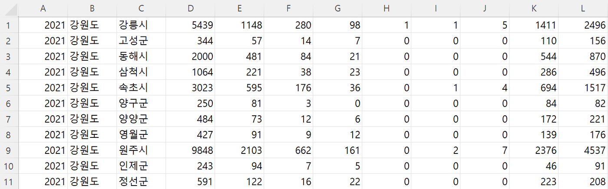
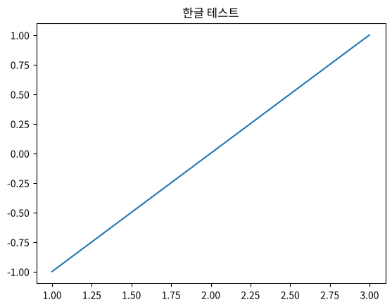

## 학습 목표
- 실습 데이터(112 신고 빈발지)의 구조를 이해함
- 분석 질문과 진행 순서를 파악함
- Colab에서 그래프에 한글이 나오게 설정할 수 있음

## 1. 실습 데이터
### 신고 빈발지 데이터
- 출처: **스마트치안 빅데이터 플랫폼** — 시군구별 112 신고 건수
- 파일
  - `범죄 빈발지 데이터(행정동단위).csv` — 본 데이터 (**헤더 없음**)
  - `범죄 빈발지 데이터(행정동단위)_컬럼정의서.xls` — 열 정의



*신고 빈발지 원본 CSV (헤더 없음)*

### 컬럼정의서

| 순서 | 영문명 | 한글명 | 타입 |
|---|---|---|---|
| 1 | RPRT_YR | 신고년도 | VARCHAR |
| 2 | CTPR | 시도 | VARCHAR |
| 3 | SIGNGU | 시군구 | VARCHAR |
| 4 | TOT_RPRT_CNT | ` 총 신고수` (앞에 공백 있음) | NUMBER |
| 5 | HMVLN_RPRT_CNT | 가정폭력신고수 | NUMBER |
| 6 | DTVLNCE_RPRT_CNT | 데이트폭력신고수 | NUMBER |
| 7 | SXVLC_RPRT_CNT | 성폭력신고수 | NUMBER |
| 8 | HDNCMR_RPRT_CNT | 몰래카메라 신고수 | NUMBER |
| 9 | MRDR_RPRT_CNT | 살인 신고수 | NUMBER |
| 10 | INTSY_RPRT_CNT | 강도 신고수 | NUMBER |
| 11 | THEFT_RPRT_CNT | 절도 신고수 | NUMBER |
| 12 | VIOLNC_RPRT_CNT | 폭력 신고수 | NUMBER |

> 한글 열 이름에 공백이 섞여 있음(`' 총 신고수'`, `'폭력 신고수'` 등). 열을 고를 때 이름을 **정확히** 써야 함

## 2. 분석 시나리오
### 전처리 → [13 문서](/lectures/python/13_report-preprocessing/)
1. 열 이름 추가
2. 조건에 따른 필터링 (서울만)
3. 인덱스 지정 (시군구)
4. 필요 없는 열 제거

### 분석

| 질문 | 방법 | 문서 |
|---|---|---|
| 신고 종류에 따라 신고 수가 다른가? | 종류별 합계, 막대그래프 | [14](/lectures/python/14_seaborn-analysis/) |
| 구에 따라 신고 수가 다른가? | 구별 합계, 막대그래프, 지도 | [14](/lectures/python/14_seaborn-analysis/), [15](/lectures/python/15_folium-map/) |
| 구별·신고 종류별 신고 수는? | heatmap, 상위 5개 구, 구별 상위 5개 종류 | [14](/lectures/python/14_seaborn-analysis/) |
| 신고 종류끼리 관련이 있나? | 상관관계 heatmap | [14](/lectures/python/14_seaborn-analysis/) |
| 신고 수와 실제 범죄 발생이 관련 있나? | 범죄 데이터 병합, 상관관계, 산점도 | [16](/lectures/python/16_crime-merge-correlation/) |

## 3. 준비 셀

```python
# 1) 드라이브 마운트 후 데이터 폴더로 이동 (00 문서 참고)
from google.colab import drive
drive.mount('/content/drive')
%cd /content/drive/MyDrive/python-ds/data

# 2) 라이브러리
import numpy as np
import pandas as pd
import matplotlib.pyplot as plt
import seaborn as sns
```

## 4. 그래프에 한글 설정 (Colab)
Colab 서버(리눅스)에는 한글 폰트가 없어서 그래프의 한글이 □□로 나옴. Windows의 맑은고딕 경로(`C:/Windows/Fonts/malgun.ttf`)는 Colab에서 쓸 수 없으므로, 나눔폰트를 설치해 등록함

```python
# 나눔폰트 설치
!apt-get -qq install -y fonts-nanum > /dev/null

import matplotlib.pyplot as plt
import matplotlib.font_manager as fm

# 설치한 폰트를 matplotlib에 등록 (런타임 재시작 불필요)
fm.fontManager.addfont('/usr/share/fonts/truetype/nanum/NanumBarunGothic.ttf')
plt.rc('font', family='NanumBarunGothic')
plt.rc('axes', unicode_minus=False)   # 음수 부호(-)가 깨지지 않게
```

확인:

```python
plt.title('한글 테스트')
plt.plot([1, 2, 3], [-1, 0, 1])
plt.show()
```



*실행 결과*

> 런타임이 끊기면 설치한 폰트도 사라짐. **새 세션마다 이 셀을 먼저 실행**할 것

## 정리
- 본 데이터는 헤더가 없으므로 열 이름은 컬럼정의서에서 가져옴
- Colab 한글 폰트: `fonts-nanum` 설치 → `addfont` → `plt.rc('font', ...)`
