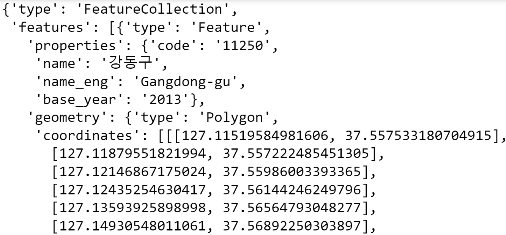
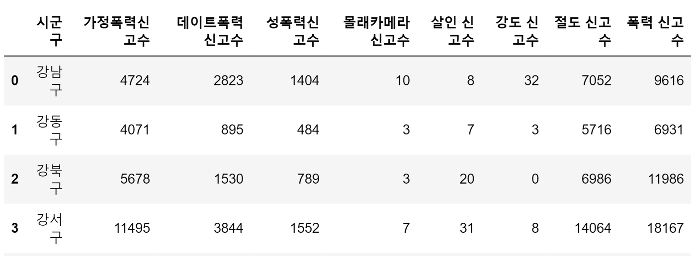
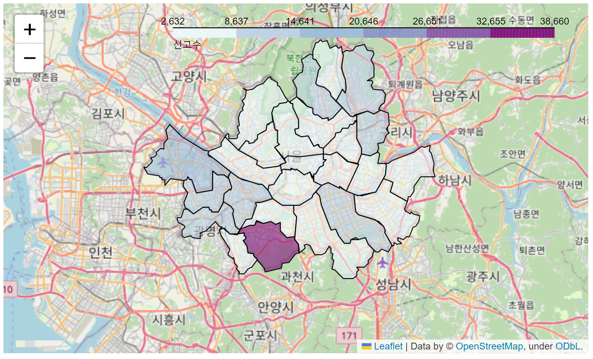
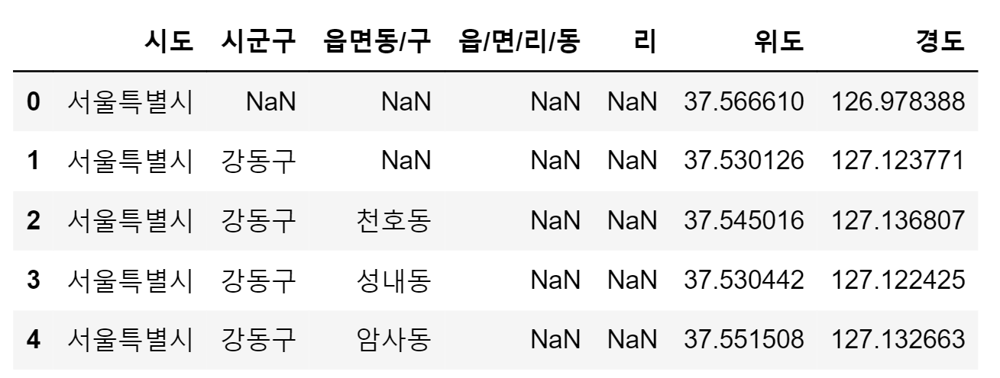
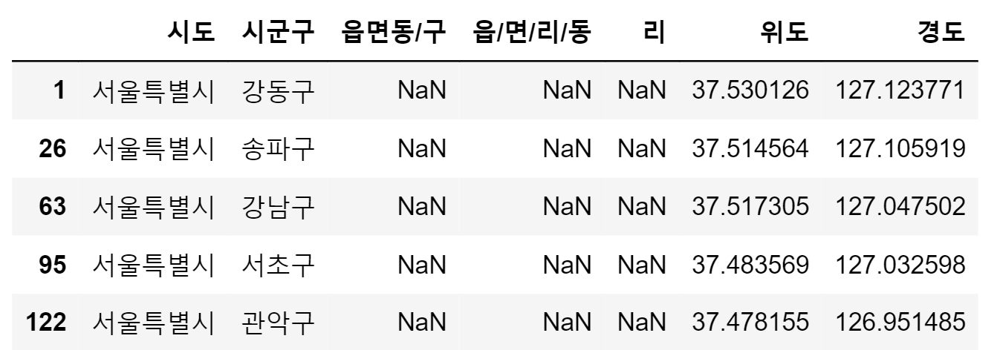
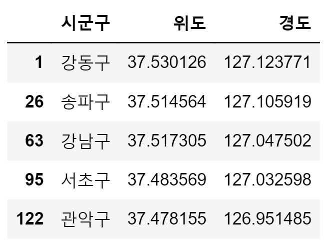
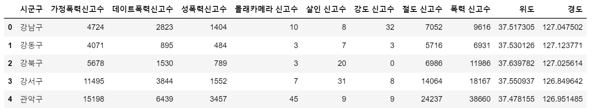
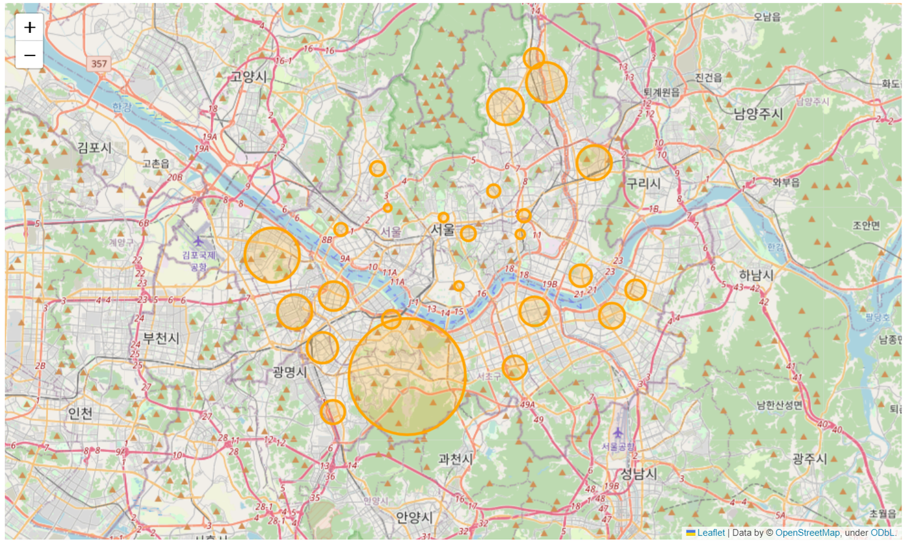

## 학습 목표
- Folium으로 단계구분도(Choropleth)를 그릴 수 있음
- 위경도 데이터를 병합해 원(Circle) 지도를 그릴 수 있음

> 전제: [13 문서](/lectures/python/13_report-preprocessing/)에서 `seoul_2021`을 만들었음

## 1. Folium
- 지리 공간 데이터를 시각화하는 파이썬 라이브러리임
- 인터랙티브 지도용 자바스크립트 라이브러리 **Leaflet.js**를 파이썬에서 쓰게 해 줌
- 확대·축소·툴팁이 되는 지도가 Colab 셀 결과로 바로 나옴

```python
# Colab에는 기본 설치되어 있음. 없으면:
# !pip install -q folium
import folium
```

## 2. 구 경계 데이터 가져오기 (GeoJSON)

```python
import folium, requests, json

url = 'https://raw.githubusercontent.com/southkorea/seoul-maps/master/kostat/2013/json/seoul_municipalities_geo_simple.json'
response = requests.get(url)
seoul_geo = json.loads(response.content)
seoul_geo['features'][0]['properties']   # {'name': '강동구', ...} 형태 확인
```



*서울 구 경계 GeoJSON*

## 3. 시군구를 열로 바꾸기
Choropleth는 **열 이름**으로 데이터를 연결하므로 인덱스를 열로 되돌림

```python
seoul_2021_gu = seoul_2021.reset_index()
seoul_2021_gu.head()
```



*인덱스를 열로 되돌린 결과*

## 4. 단계구분도 (Choropleth)
값의 크기를 색 농도로 보여 줌

```python
m = folium.Map(location=[37.541, 126.986], zoom_start=10)   # 서울 중심 좌표
folium.Choropleth(
    geo_data=seoul_geo,
    data=seoul_2021_gu,
    columns=('시군구', '폭력 신고수'),          # (연결할 키 열, 색칠할 값 열)
    key_on='feature.properties.name',           # GeoJSON 안의 구 이름 위치
    fill_color='BuPu',
    legend_name='신고수'
).add_to(m)
m
```



*폭력 신고 수 단계구분도*

> `시군구` 값과 GeoJSON의 `name` 값이 **글자까지 똑같아야** 색이 칠해짐

## 5. 행정구역별 위경도 처리
### 위경도 파일 불러오기

```python
latlng = pd.read_excel('행정구역별_위경도_좌표.xlsx')
latlng.head()
```



*행정구역별 위경도 원본*

### 서울시 전체 행 제거

```python
latlng = latlng.iloc[1:, :]     # 첫 행(서울특별시 전체) 제거
latlng.head()
```



*서울시 전체 행 제거*

### 구를 대표하는 위경도만 추출
읍면동 값이 비어 있는 행이 구 대표 좌표임

```python
latlng = latlng[latlng['읍면동/구'].isna()]
latlng = latlng[['시군구', '위도', '경도']]
latlng.head()
```



*구 대표 위경도*

## 6. 원(Circle)을 이용한 지도
### 신고 데이터와 위경도 병합

```python
seoul_2021_gu = pd.merge(seoul_2021_gu, latlng, on='시군구', how='inner')
seoul_2021_gu.head()
```



*신고 데이터와 위경도 병합*

### 폭력 신고 수를 원 크기로

```python
m = folium.Map(location=[37.541, 126.986], zoom_start=11)
for i in range(len(seoul_2021_gu)):
    folium.Circle(
        location=[seoul_2021_gu['위도'][i], seoul_2021_gu['경도'][i]],
        tooltip='{}: {}'.format(seoul_2021_gu['시군구'][i], seoul_2021_gu['폭력 신고수'][i]),
        radius=seoul_2021_gu['폭력 신고수'][i] / 10,      # 반지름(m)
        color='orange',
        fill_color='orange'
    ).add_to(m)
m
```



*폭력 신고 수를 원 크기로 표시한 지도*

> `merge` 뒤 인덱스가 0부터 다시 매겨지므로 `[i]`로 접근할 수 있음. 같은 코드를 `for _, row in seoul_2021_gu.iterrows():`로 쓰면 인덱스 걱정이 없음

### 지도 저장

```python
m.save('seoul_violence_map.html')   # 브라우저로 열 수 있는 HTML 파일
```

## 정리

| 지도 | 핵심 코드 | 필요한 데이터 |
|---|---|---|
| 단계구분도 | `folium.Choropleth(...)` | 구 경계 GeoJSON + 구 이름 열 |
| 원 지도 | `for` + `folium.Circle(...)` | 구별 위도·경도 |
